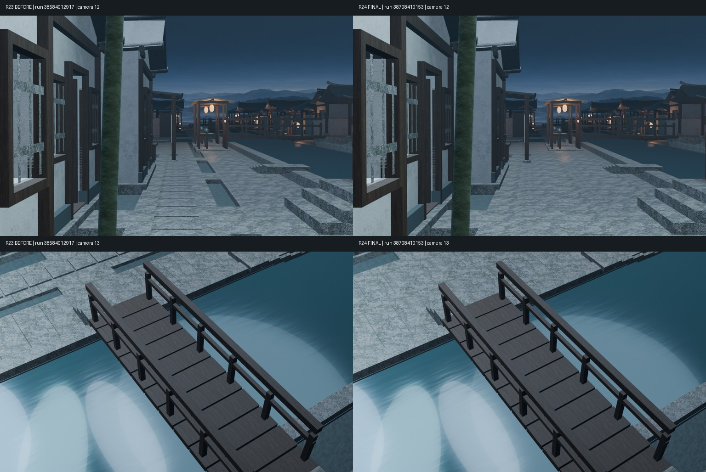
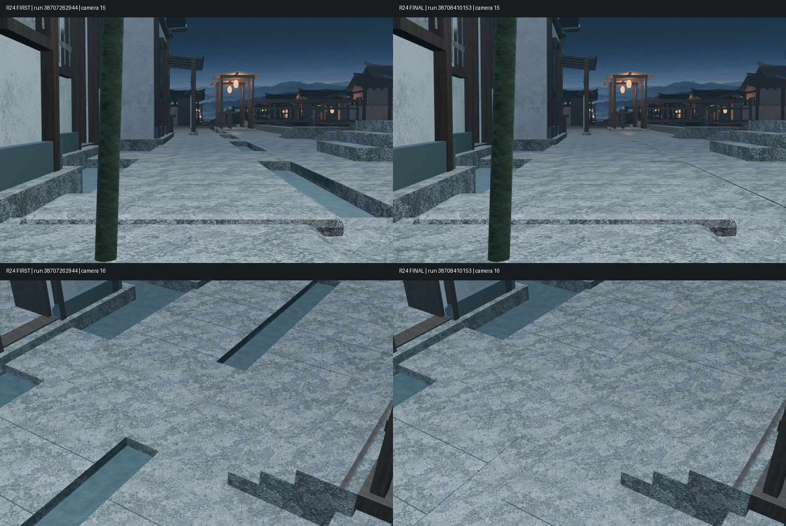
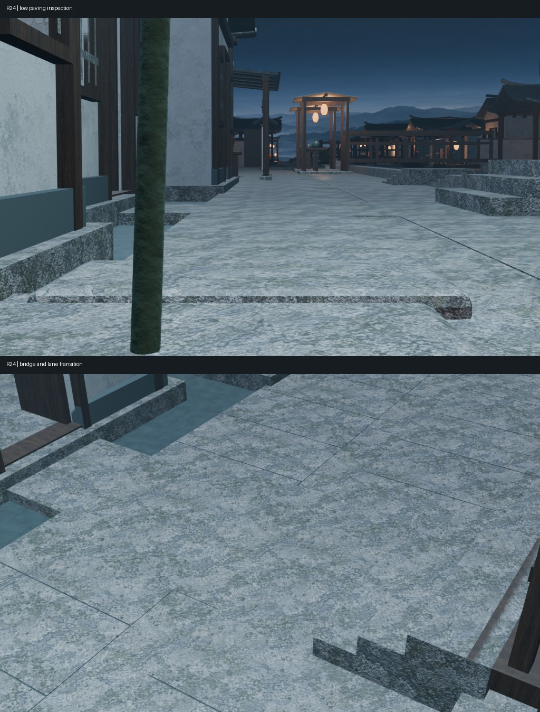
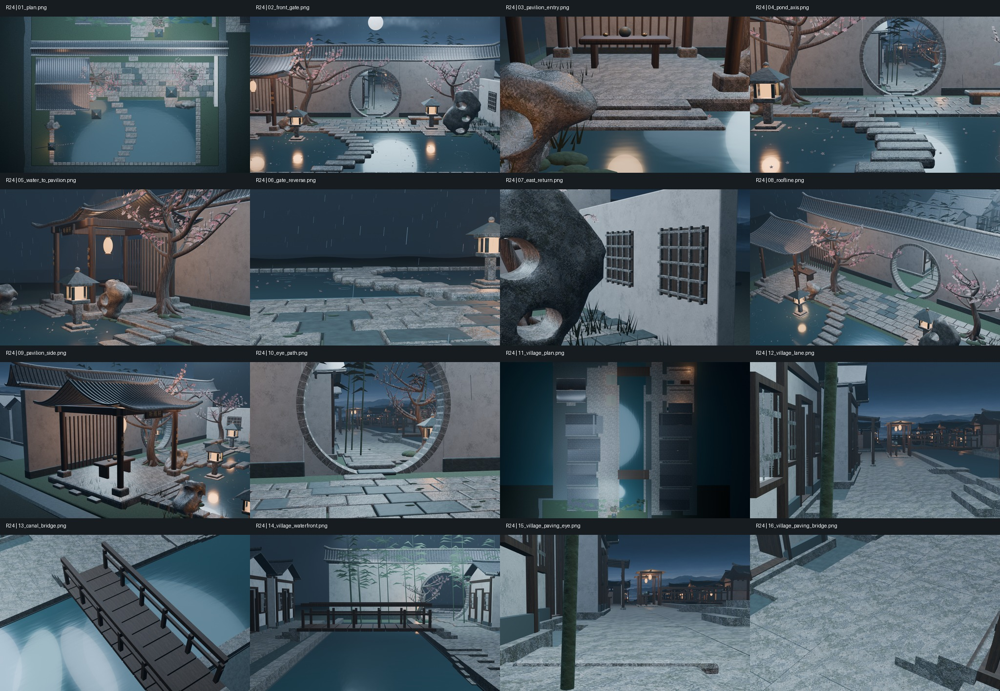

# Round 24｜原村巷铺地连续性修复

这些图片均来自真实Blender模型，不是概念图。

- 整体库：XDHRY/yanyu-jiangnan；独立客栈库未改动。
- 基线：main@e5ae0b75f3b78c4b3ec9941f2deb03caa1169ece。
- [PR #30](https://github.com/XDHRY/yanyu-jiangnan/pull/30)。终版源码头：f79f31bf2a72c65d66787f1716bdfdcf1ede2ee1。
- 四项机器门禁通过后合并至main：b7112269d0123f324471f93442fdf4738837376d。人工门禁仍pending。
- 最终实渲：[Run 38708410153](https://github.com/XDHRY/yanyu-jiangnan/actions/runs/38708410153)，测试合并commit 50f622f4a74e60add9226f4aceb3ac69c5f1b607。
- 旧图来源：Round 23 / Run 38584012917；本轮首版：Run 38707262944。

## 同机位基线与终版

左为Round 23，右为Round 24终版。相机12、13参数未改。

## 本轮两次实渲迭代

左为本轮首版，右为终版。首版消除了旧汀步60mm高差，却仍保留两巷间0.43m裸露地基条带；终版将条带补至街面下8mm。

## 最终重点机位与完整拼图

## 可下载产物与机器证据

- [可编辑Blender](https://github.com/XDHRY/yanyu-jiangnan/actions/runs/38708410133/artifacts/11958973148)
- [完整16张1024×640 PNG与空间检查](https://github.com/XDHRY/yanyu-jiangnan/actions/runs/38708410153/artifacts/11959427857)
- [GLB与独立Web Viewer](https://github.com/XDHRY/yanyu-jiangnan/actions/runs/38708410144/artifacts/11959657392)
- [asset_budget.json](asset_budget.json)；[validation.json](validation.json)；[机位manifest](diagnostic_manifest.json)；[场景统计](scene_statistics.json)。

终版4382对象、2883 Mesh、1411 Curve、162642实例展开网格三角面；44材质、7张打包图片、41.99MiB纹理估算。16图210.80秒。新增4个闭合盒体、48个源码三角面；无新增位图、付费素材或屋面。Smoke与Spatial独立构建统计一致。三角面口径不包含全部修改器求值。

Function / Form / Runtime人工门禁仍为pending。运行时碰撞、导航、正式LOD和导出后UV/法线专项审计未宣称通过。

[持续交接与下一轮动作](../../iterations/20261015-village-paving-repair.md)
