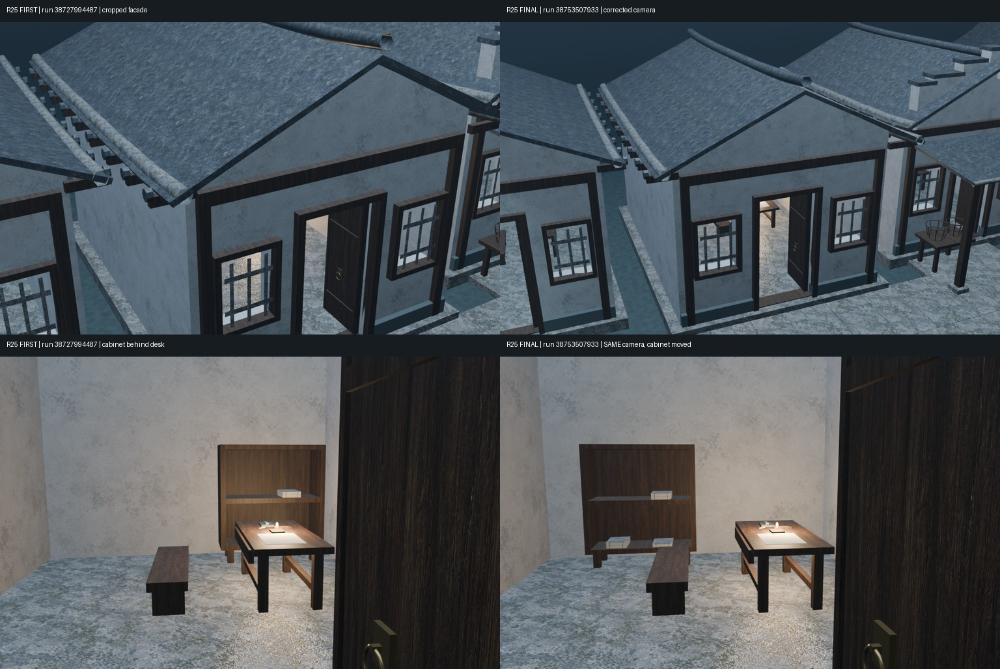
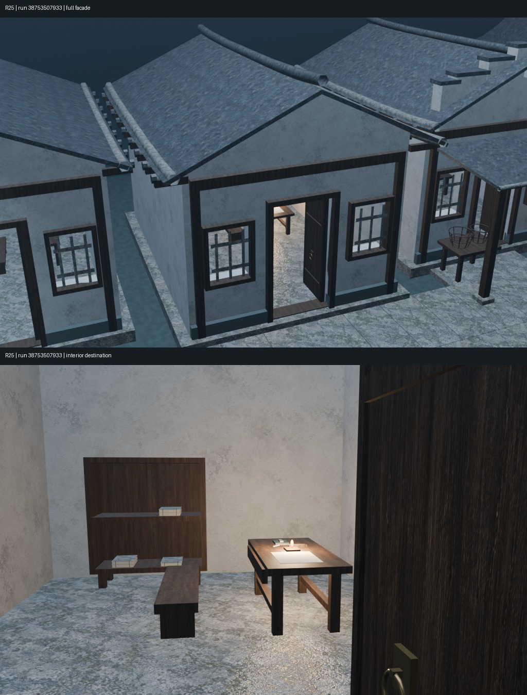
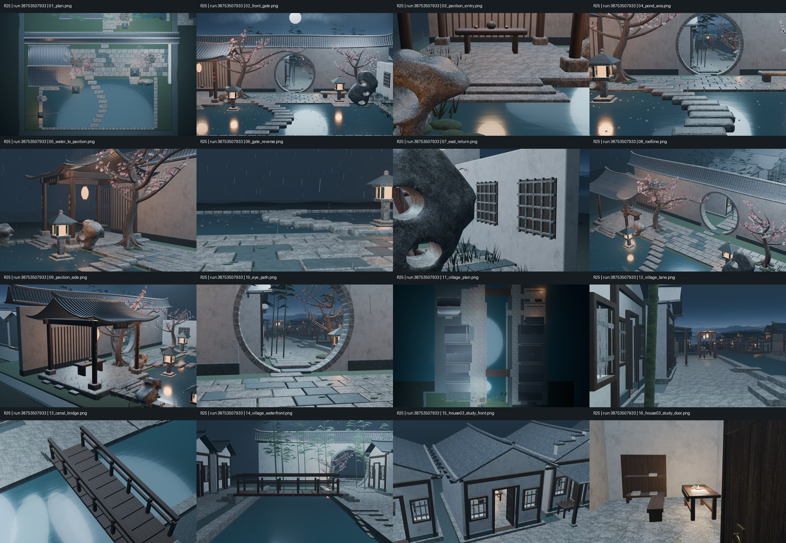
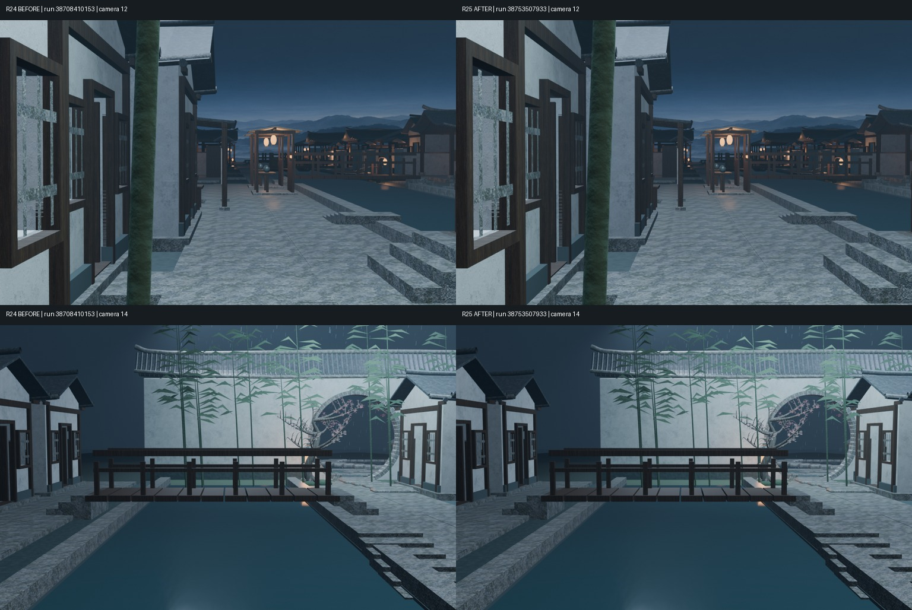

# Round 25｜西岸书户入户木作与书房去向

全部为真实Blender模型渲染，不是概念图。

- 仓库：XDHRY/yanyu-jiangnan；独立客栈库未改动。
- 基线：main@f7dfabd4942f3a041c3f3cde601b5991d9473e40，完整包含原村落和Round24铺地修复。
- [PR #31](https://github.com/XDHRY/yanyu-jiangnan/pull/31)，终版源码df0c774c08f932ce53a5ab38ac54cd67548ecd2b。
- 已合入main，合并提交e4161b6ee7bb5817de831b74fd805132880c446e；人工门禁仍pending。
- 终版[Run 38753507933](https://github.com/XDHRY/yanyu-jiangnan/actions/runs/38753507933)，测试合并树202ffb285b3a43a10cec2f1a33d20afba0d7b3e8。
- 本轮首版Run 38727994487；基线旧图Round24 / Run 38708410153，图片标签明确标注。

## 两轮实渲前后对比

上排：首版裁切，终版后退放宽外景机位，检查整屋屋檐—柱梁—台基。
下排：室内机位完全不变；终版将书格由案几后方移至侧后方，避免下层书册被遮挡。

## 终版重点机位

## 完整16机位

## 上轮核心机位基线对比

前14机位均未改动。下图左为Round24，右为Round25；本轮局部书房不应改变村落总体轮廓。

## 验证和下载

CI、Smoke、Spatial、Web全部通过。4436对象、2924 Mesh、1424 Curve；实例展开网格163134三角面，余6866；44材质、7图像、41.99MiB纹理估算，16图311.17秒。保守计入门扇五金后的净宽1.008m。八类重复件共享Mesh，无新位图、付费素材或屋面。

- [完整16张1024×640 PNG与验证](https://github.com/XDHRY/yanyu-jiangnan/actions/runs/38753507933/artifacts/11983565218)
- [可编辑Blender](https://github.com/XDHRY/yanyu-jiangnan/actions/runs/38753508015/artifacts/11982481696)
- [GLB及独立Web Viewer](https://github.com/XDHRY/yanyu-jiangnan/actions/runs/38753508025/artifacts/11982662464)
- [性能](asset_budget.json) · [断言](validation.json) · [实渲manifest](diagnostic_manifest.json) · [场景统计](scene_statistics.json)

三角面口径不含全部修改器求值及Curve转网格；RGBA8纹理估算不是实际GPU显存。Smoke与Spatial独立构建统计一致。

Function/Form/Runtime人工门禁仍pending，碰撞、导航、正式LOD及专项导出UV/法线未宣称完成。室内细腻度、门扇近景占画与局部暗部继续保留为美术债务。

[持续交接与下一轮](../../iterations/20261015-house03-study.md)
