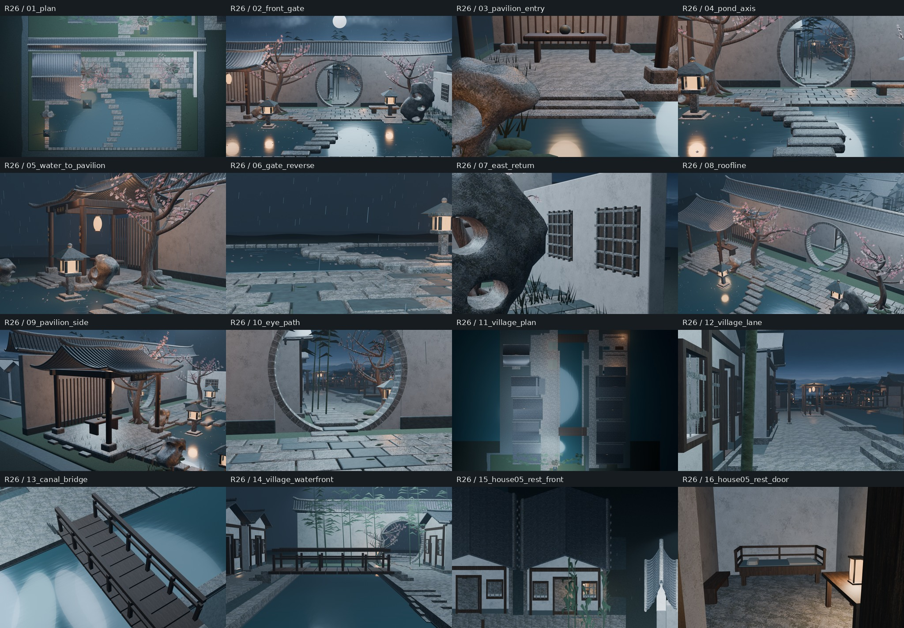
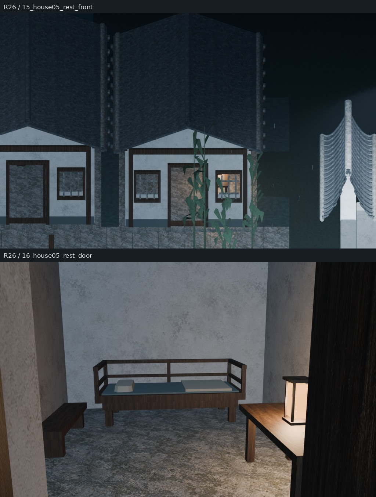
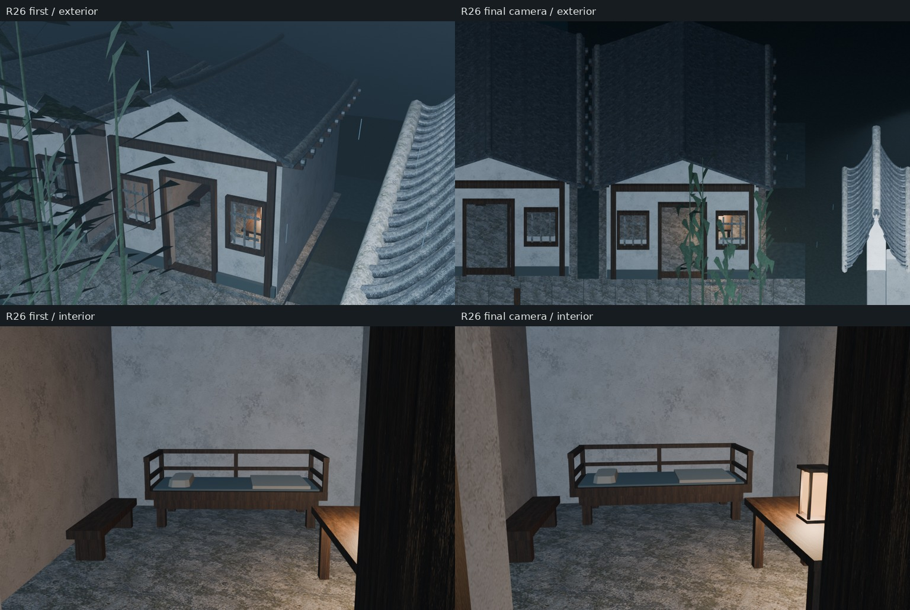
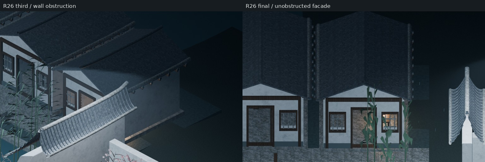

# Round26｜东岸起居户真实审阅包

源仓库：XDHRY/yanyu-jiangnan（不是独立客栈库）。

- 基线main：67274e439051e24531d6fd917667978c48974b91。
- [PR32](https://github.com/XDHRY/yanyu-jiangnan/pull/32) 终版源码：56959472d82928209c29985e733d1ae38310b044。
- Actions测试合并树见diagnostic_manifest.json的source_commit。
- [终版16机位Run38802264823](https://github.com/XDHRY/yanyu-jiangnan/actions/runs/38802264823)。只轮换15/16，01–14与基线AST一致。1024×640 Eevee低成本诊断，无36机位正式渲染。

## 真实渲染，不是概念图

15号虽消除南侧前墙遮挡，但竹叶仍压到入口、后段屋面仍裁边，未作为完整外观验收通过。16号室内家具和案灯可辨；当前仍为低成本诊断，不代表最终美术或运行时验收。

## 本轮首版与机位修正

首版Run38778379597，源码a76eb5c13b5b014019db2d2a51c9172a0993b7de。首版外景竹叶遮挡和屋脊裁边，案灯被门扇挡住。第二版Run38779373057案灯可见，但屋面仍裁边；第三版Run38780484446改用13米宽正交外景，却被庭院前墙挡住入口。终版15号改为水街正对立面的正交机位。全程只修改两个观察机位；模型、材质、灯光完全相同。此对比不是几何改良或新增资产的前后对比。

## 验证与源文件

- validation.json：Smoke/空间/支撑断言；床足—地坪、榻面—薄垫、枕毯承托、灯底—案面、家具避让及共享Mesh。
- asset_budget.json：实际对象、网格实例展开面数、材质、纹理估算与预算警告。
- diagnostic_manifest.json：16张图的精确机位、源码树和逐图耗时。
- scene_statistics.json：独立场景统计。
- 完整原图、可编辑Blender和GLB链接见main上的[本轮交接](../../iterations/20261016-house05-rest.md)。Actions原始大产物有保留期限，本分支的拼图与JSON为Git持久审阅证据。

Function/Form/Runtime人工门禁仍pending。室内1米避让条带不等于原门洞净宽或运行时导航合格；LOD、完整碰撞与导出UV/法线审计未完成。预算未计全修改器求值与Curve转网格，RGBA8估算不是实测GPU驻留显存。
