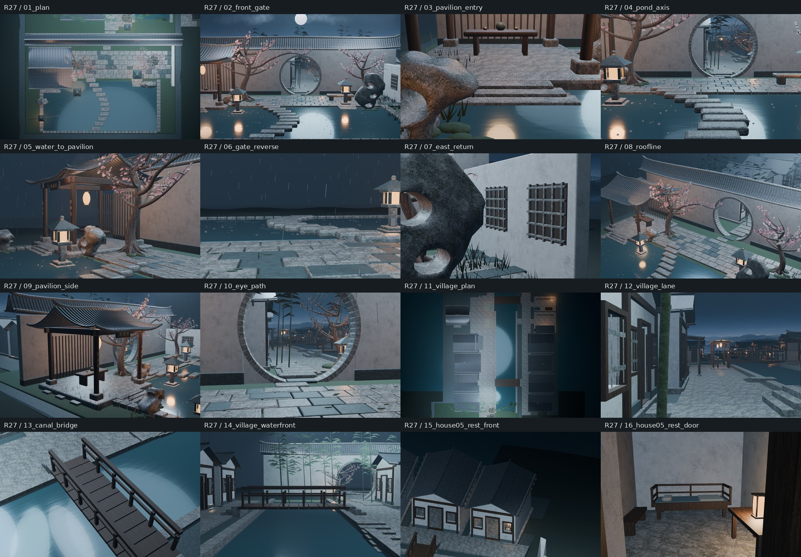
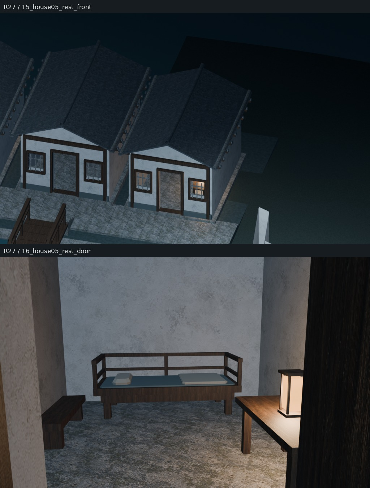
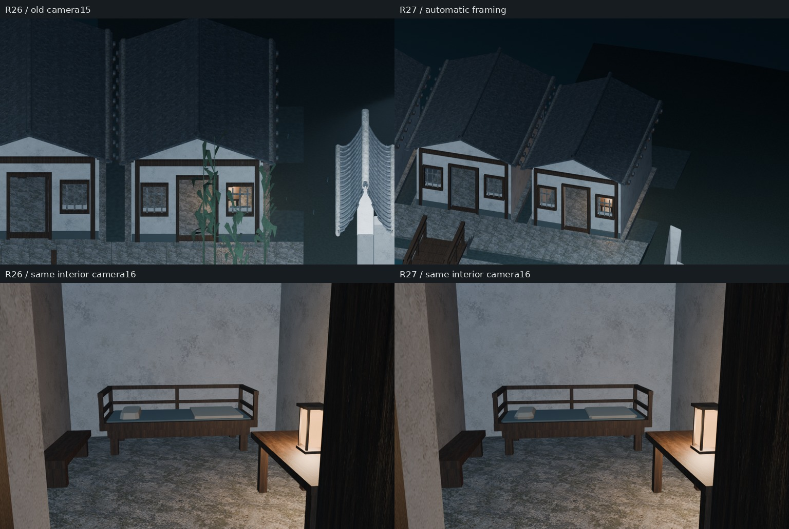
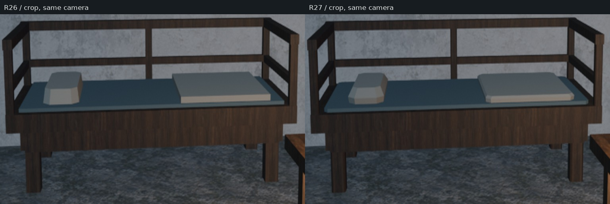

# Round27｜起居榻轮廓与外景修复真实审阅

整体仓库XDHRY/yanyu-jiangnan；基线0058ccf9ccbb9605abdbf2cc3bf40ab97597fb74，独立客栈库未改动。

- [PR33](https://github.com/XDHRY/yanyu-jiangnan/pull/33)，终版源码dc9d4f51b6870fce145b58213b9b107f3f52e4d5。
- [实渲Run38824568244](https://github.com/XDHRY/yanyu-jiangnan/actions/runs/38824568244)，测试合并树80470a2001c4b0827a91a6f16a365180d8a06f6d。
- 四项机器构建成功；163834展开三角面，16图163.78秒；人工Function/Form/Runtime仍pending。

## 本轮真实模型渲染

## 前后对照

左为Round26 Run38802264823旧图，右为本轮。上排更换外景机位并自动适配完整本户边界；下排16号机位完全不变，用于比较真实模型轮廓变化。不是概念图。

以下为同一16号画面相同像素区域裁切放大，未重绘：

四足和五柱共享倒角截面；薄垫八角轮廓、毯枕三环24顶点，合计新增240三角面，没有新增对象、材质、图片或付费资产。实际支撑接触与床品闭合检查通过。15号本户的完整屋面、门窗、台基均入画，三条门口观察射线无遮挡，未隐藏建筑或植物。

## 机器证据与边界

- diagnostic_manifest.json为原始Actions manifest。注意target是初始请求目标，不是自动平移相机后的轴向目标；camera_framing.json记录明确的最终姿态复现参数。
- asset_budget.json、validation.json和scene_statistics.json保留实际计数、接触与增量断言。
- [持续交接与大产物下载](../../iterations/20261016-house05-profile.md)。原始Actions产物有期限，本分支拼图与JSON为Git持久记录。
- 本轮首版因预检传参错误，Spatial38824292965及Web38824292897失败，没有有效实图；修正后才取得本包证据，未将失败构建算作通过。

仍有布料偏硬、围栏木作过简等造型债务。碰撞导航、LOD、导出UV/法线与运行时验收待完成；网格预算不含全部修改器与Curve转网格，纹理估算不是实际GPU显存。
