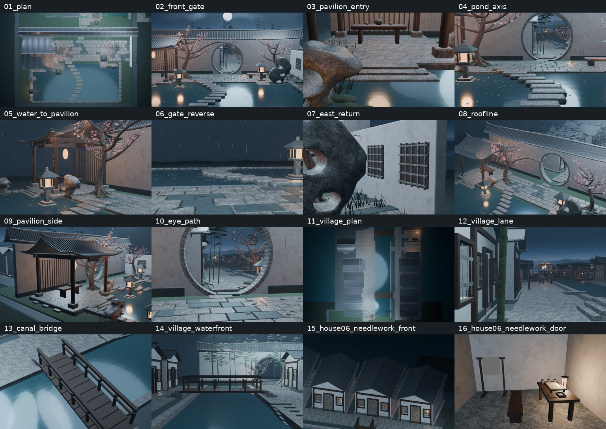
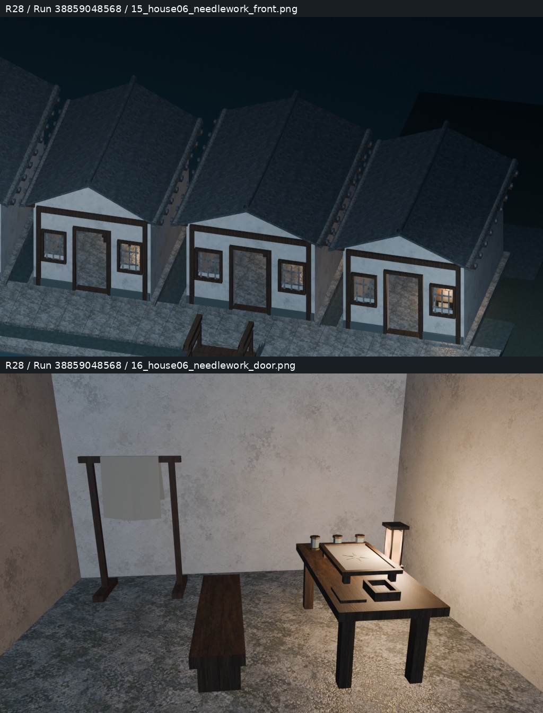
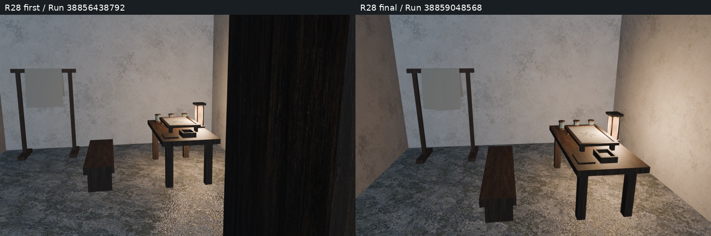

# Round28｜东岸针线户真实审阅包

源码8945f7defdabc9b86d6a6bec80562162e5bbfdda；测试树086da629762e7e5826c74288160693cf7481f9fb；PR34合并05b0bc4ac38c63997131567064a770e7ee557f79。
本目录图像均来自Blender实际产物，不含概念图。

对比左：本轮首批Run38856438792；右：终版Run38859048568。机位与搭布折面均变化，不是同角度材质对比。终版家具及建筑边界检查和实际焦距见diagnostic_manifest.json；前14固定机位保留。
实际新增：绣框、绷布/针脚、三线轴、开口针盒、针、落地布架/搭布、纸罩案灯；复用原材质，无新贴图或屋面。4521对象，164746网格三角面，净增912；46材质、7图、41.99MiB纹理估算；16图299.05秒，警告0。Smoke/Spatial独立统计一致。
四项机器检查通过；人工Function/Form/Runtime、完整碰撞导航、LOD和UV/法线仍pending。Web巡游预设仍为旧15/16，与本轮诊断图不同，已记录下一轮同步；不将Web构建成功当成人工运行时批准。

[持续交接](https://github.com/XDHRY/yanyu-jiangnan/blob/main/docs/iterations/20261016-house06-needlework.md)
[原始16图与验证](https://github.com/XDHRY/yanyu-jiangnan/actions/runs/38859048568/artifacts/12028038190)
[可编辑模型](https://github.com/XDHRY/yanyu-jiangnan/actions/runs/38859048519/artifacts/12028391579)
[GLB/Web产物](https://github.com/XDHRY/yanyu-jiangnan/actions/runs/38859048607/artifacts/12028956267)

