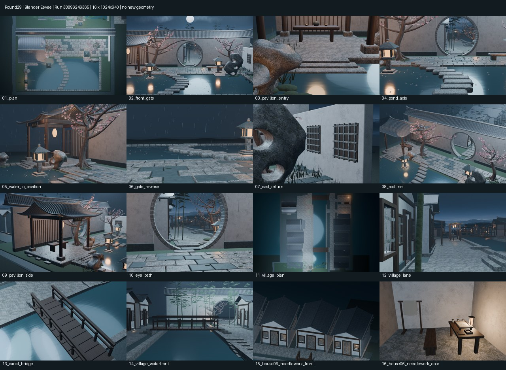
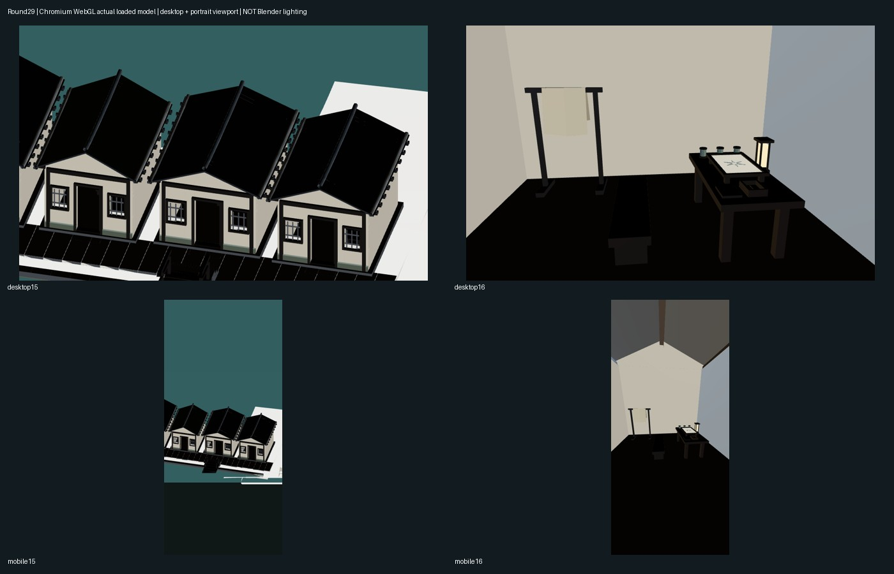
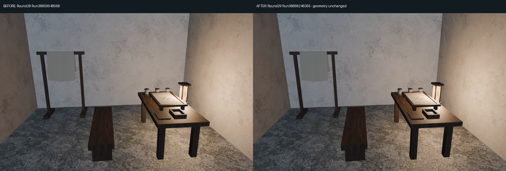

# Round29 实际构建审阅包

本轮修复网页相机管线，不新增模型、材质或贴图。整体仓库 XDHRY/yanyu-jiangnan；独立客栈仓库未改动。

首批源163663a3717f001eeed0b653f3a63aa4ddb573e3，Spatial38895049343（合并树912eb60ba695b93a58ff0080531ffca2251779b7）生成16张1024×640 Blender Eevee图片，310.80秒。首批Web38895049504实载姿态检查超时，未通过，未将其作为验收。

二次源c27851a172dd9f45e18635d8c6c0cd8a893d4389，Actions合并树269ca527f9c445dc9339db52ccd6c638a04cac27；CI38896246444、Smoke38896246337、Spatial38896246365、Web38896246430全部成功。PR35已合并为2df2af484efe6977fdc4d0abc1651736211bcca6。

`round29-contactsheet.jpg` 是终版Spatial38896246365实际16图缩略拼图，不是概念图；`round28-29-blender-compare.jpg` 左侧来自上轮Run38859048568、右侧来自本轮终版Run38896246365，刻意展示几何未变，不是材质升级前后对比。每张原始PNG保留在diagnostics。`round29-browser-audit.jpg` 是Web38896246430实际Chromium截图拼图；4张原始截图与相机姿态报告在runtime-audit。

终版16图315.07秒，4521对象、164746原始实例展开网格三角面、46材质、7贴图，纹理RGBA8估算41.99MiB，较上轮新增全部为0；非完全求值几何及真实GPU显存统计。4张网页截图相机位置误差0、最大角误差2.98e-8弧度，页面错误0，GLB16机位投影核对通过。

本轮已知未完成：网页屋瓦、地坪、木作明显偏黑，PBR/程序材质转译不完整，列为下一轮P1；竖屏虽保留构图但主体偏小，列P2。没有声称网页材质或手机真机体验获批。

完整下载包解压后在该目录运行 `python -m http.server 8000`，用浏览器打开 http://localhost:8000；本地服务只用于载入同目录GLB，HTML/JS/GLB均在包内。Actions亦提供单文件HTML版本。

- [PR35](https://github.com/XDHRY/yanyu-jiangnan/pull/35)
- [16图与预算artifact12043744812](https://github.com/XDHRY/yanyu-jiangnan/actions/runs/38896246365/artifacts/12043744812)
- [网页与截图artifact12044496387](https://github.com/XDHRY/yanyu-jiangnan/actions/runs/38896246430/artifacts/12044496387)
- [完整交接](https://github.com/XDHRY/yanyu-jiangnan/blob/main/docs/iterations/20261016-web-camera-parity.md)

本轮依build-3d-game-rooms技能将实际证据、机器门禁与人工批准分开；审阅包已按library技能持久保存，仓库源码不重复打包。

Function/Form/Runtime人工批准仍pending。浏览器导出不包含Blender灯光、雨雪效果；软件WebGL模拟桌面和竖屏视口不是用户真机验收。

## 终版实际图

