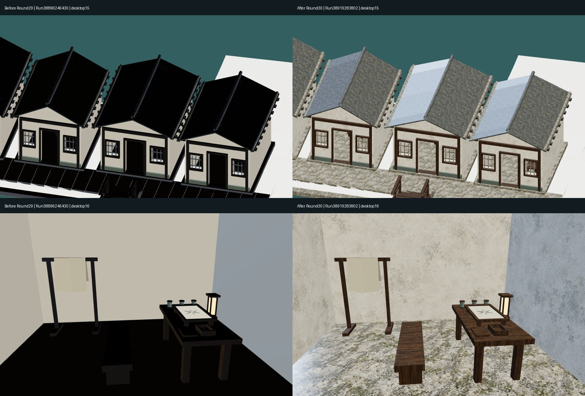
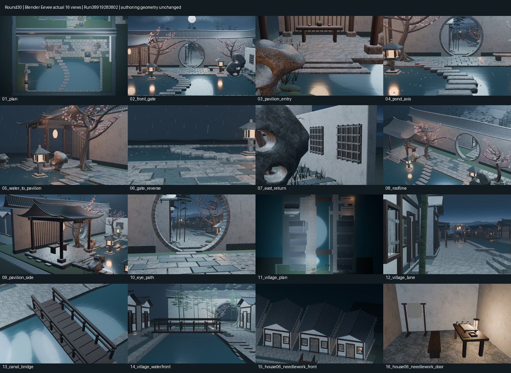

# Round30 网页材质修复真实审阅

源码1087d4047a488204752456dae3b6b3301f5ae655，Actions合并树c3554cbdbc85a73b7af8cb9d1f173f0df3604763。[PR36](https://github.com/XDHRY/yanyu-jiangnan/pull/36)已合并为9d61e399e1240ce35b12071265174fde57a430ba。

本轮没有新增房屋、模型、位图或付费资产。修复导出材质中底图误作法线、BOX图像缺少UV及隐藏原型泄漏。Blender作者场景、灯光、16机位、网页灯光及前端bundle均未变化。

## 同机位网页实截前后对比

左为Round29 Run38896246430，右为本轮终版Run38919283802。均为Chromium真实加载的模型，不是概念图，也不是Blender夜景渲染。未用曝光调整冒充材质改进。

## 本轮16张Blender诊断

Run38919283802，16张1024×640实际Eevee图，303.51秒。作者场景未改，因此不以这些图冒充新增模型。

## 验证与代价

- CI38919284003、Smoke38919284045、Web38919283802通过；5项Python与3项Node回归测试通过。
- 1518个带底图片段的UV检查通过，错误底图/法线复用0；采用几何法线降级，真正Normal/AO烘焙仍pending。92面使用归一化回退UV，不是精修展开。
- 导出626279求值三角面，与Round29完全相同；7图片RGBA8估算41.99MiB，未增长。
- UV有开销：GLB52897192字节，比上轮增加8407840；属性/索引缓冲估算增加8127424字节。不是零内存增长，也不是实际GPU驻留或手机帧率测试。
- 当前网页木石瓦纹理可读，但石瓦粗亮、接缝、竖屏主体偏小及8米近似旋转中心仍待精修。Function/Form/Runtime人工批准、碰撞导航和正式LOD仍pending。

完整ZIP中的jiangnan-town-standalone.html可解压后直接打开；内嵌图集为640×400预览，diagnostics目录保留16张1024×640原始PNG。HTML内嵌完整原始GLB，运行extract_model.py可无损取出jiangnan-town.glb供Blender等软件编辑。runtime-audit保存4张原始网页截图与相机报告；export-performance.json保存独立解析结果。手机大文件加载仍依设备内存，不宣称真机验收。

- [完整交接与三批验证记录](https://github.com/XDHRY/yanyu-jiangnan/blob/main/docs/iterations/20261016-web-material-repair.md)
- [Actions完整原图/GLB/Web产物12054645611](https://github.com/XDHRY/yanyu-jiangnan/actions/runs/38919283802/artifacts/12054645611)
- [可编辑Blender构建12054291498](https://github.com/XDHRY/yanyu-jiangnan/actions/runs/38919284045/artifacts/12054291498)

本轮使用build-3d-game-rooms技能将真实证据、机器门禁与人工批准分开记录。独立客栈库未改动。
