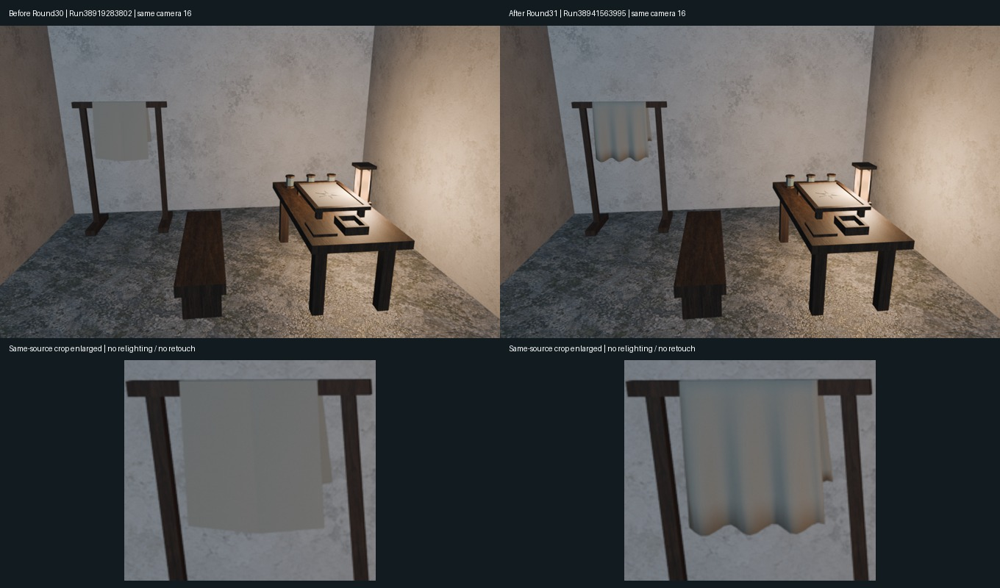
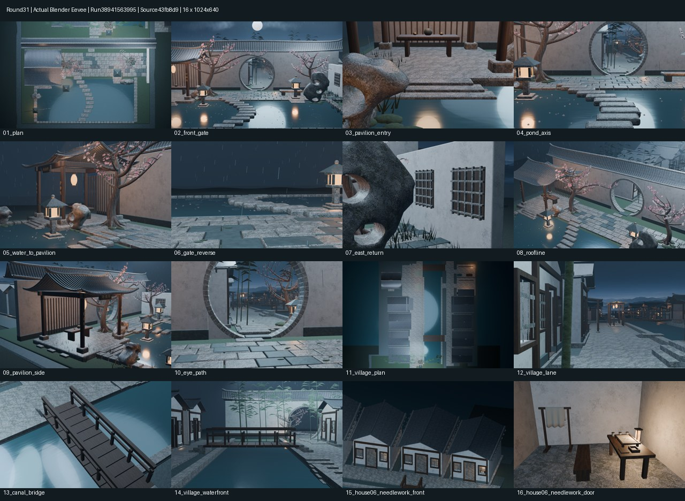

# Round31 东岸绣户搭布｜真实审阅包

源码提交43fb8d9a659f93c40fa548201b794585c52613e4；[PR37](https://github.com/XDHRY/yanyu-jiangnan/pull/37)已合并为0d4bc2929430348a792af63c6735851de2c8b7d4。产物实际测试合并提交9003ae27879a72069adae518a7b5fc79b4b8a020与最终合并的Git tree相同；整体库基线main@662daee，独立客栈库未改。

本轮仅将既有绣户后墙搭布从平板改为三道浅褶、肩部转折与轻微起伏下缘：21×11低面数网格，231顶点/200四边面，3毫米Solidify，无细分。21行布冠接1.610米顶枋；其他家具、房屋、机位与材质不变。没有新增位图。

## 同机位前后对比

左：旧Round30/run38919283802；右：本轮Round31/Spatial38941563995。上排完整第16机位，下排原图同区域放大，未重新打光、未修图；两轮全部16机位位置和投影一致。Eevee采样有微小差异，不宣称非目标像素逐点相同。

## 本轮16张真实Blender诊断

来源Spatial38941563995，长边1024，163.28秒，保留14固定+2聚焦。原图在下载包diagnostics/；不是概念图。

## 验证与性能

CI38941563927、Smoke38941563954、Spatial38941563995、Web38941563982全部通过；本地Python5项/Node3项回归通过。支撑、桌面/地坪接触、门后通道、Solidify闭合和原预算均通过。

|口径|Round30|Round31|
|---|---:|---:|
|源网格三角面|164746|165134|
|GLB实例展开求值三角面|626279|627155|
|作者对象/材质|4521 / 46|4521 / 46|
|打包图片/RGBA8估算|7 / 41.99MiB|7 / 41.99MiB|
|GLB字节|52897192|52911584|
|属性/索引缓冲估算字节|29777038|29791366|

源网格预算170000余4866；针线户相对Round27净增1300/1600余300。网格复用48.52%。求值增876含Solidify，源增388，不混用。显存数字仅RGBA8及缓冲估算，不是实际GPU驻留或手机帧率。

导出相机/材质独立复核通过：1518底图primitive无缺UV或底图/法线错用，法线贴图仍0，明确使用几何法线降级。4张Chromium WebGL/SwiftShader桌面和竖屏实截相机位置误差0，最大角误差2.98e-8，页面错误0；不是实体手机验证。运行时截图在runtime-audit/。

## 文件与追溯

- 持久独立下载包`yanyu_round31_drape_review.zip`：16原始PNG、可编辑且打包贴图的Jiangnan.blend、旧Round30第16机位对照PNG、本轮4网页实截、两拼图和JSON报告。
- [完整Spatial产物](https://github.com/XDHRY/yanyu-jiangnan/actions/runs/38941563995/artifacts/12063757207)
- [可编辑Blender源产物](https://github.com/XDHRY/yanyu-jiangnan/actions/runs/38941563954/artifacts/12063806597)
- [本轮GLB及独立HTML查看器](https://github.com/XDHRY/yanyu-jiangnan/actions/runs/38941563982/artifacts/12063652099)（Actions保留至2026-11-15；查看器包含640×400预览，原始1024图在独立包中）
- [持续交接](https://github.com/XDHRY/yanyu-jiangnan/blob/main/docs/iterations/20261017-needlework-drape.md)
- 同目录`analysis.py`可从Round30、Round31产物重建导出对比与拼图，不需要重建场景。

Function/Form/Runtime人工批准仍pending。网页石瓦粗亮、BOX投影接缝、真实PBR/切线Normal烘焙、竖屏主体偏小、正式LOD、碰撞与导航仍未完成。下一轮先把完整导出预算回归接入自动门禁，再选择单个石瓦材质做精修，不恢复36机位。
