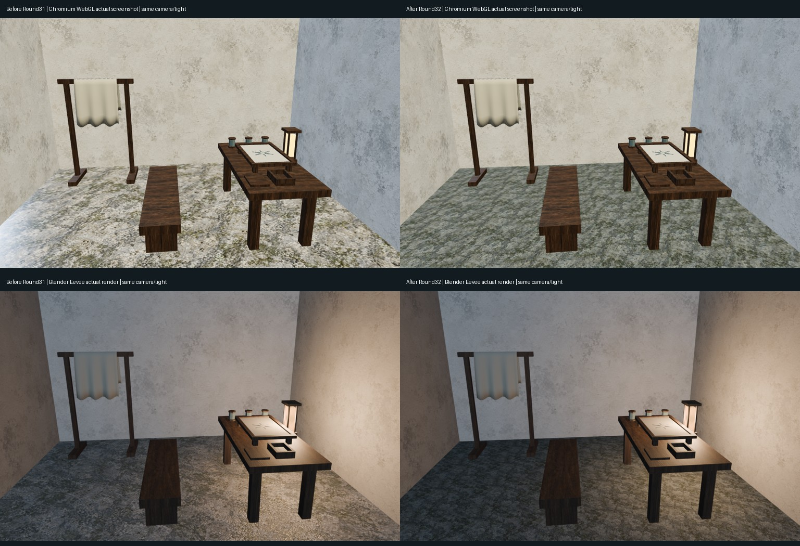
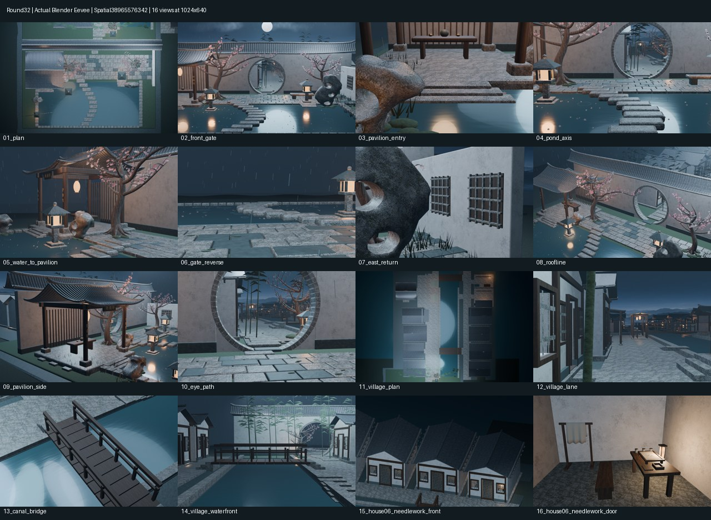

# Round32｜民居细磨青石与导出预算

本轮源码c22b6db66afad6d88e02606d8639fc1c757dabdf，[PR38](https://github.com/XDHRY/yanyu-jiangnan/pull/38)。基于完整main@03fbf76，独立客栈库未改。8栋原村民居室内地坪改为一组独立细磨青石材质，复用既有stone.png；不新增几何或位图，不改灯光、曝光、家具与机位。

PR38已合并为a2219084ad11210fb712dfce6a1c830afe71e69c，与实际测试合并提交a9df0a6946f15d0641e8aad34fdb595b7f51daf6的Git tree相同。

首批被材质范围检查拒绝：共享原型还服务后续住宅区。修正为选定8户共用一个隔离Mesh，保留其他住宅原材质；未放宽断言、未合并失败源码。该隔离会新增一个数据块，不宣称零缓冲开销。

## 真实前后对比

左：旧Round31/Web38941563982及其Blender诊断；右：本轮Round32，Web38965576491与Spatial38965576342。上排为网页实际截图，下排为Blender真实渲染。全部16机位相机位置/四元数/适配焦距/正交尺度不变；两种渲染器各自前后灯光不变，不拿网页日照与Blender夜景之间的差异冒充升级。

## 本轮16机位

以下来自Spatial38965576342；16张原始1024×640 PNG在diagnostics/。不是概念图。14固定+2聚焦保留，不恢复36机位。

## 材质与验证范围

线性BaseColor乘数(.45,.52,.54)，粗糙度.82，Specular IOR Level .25，名义重复0.556米；源Bump距离4毫米/强度.16，代替原粗石的70毫米距离。来源和许可沿用项目既有stone.png与生成提示词；没有新图片、方向光底图或付费生成。园林石、室外石街和屋瓦保持原材质。

源断言检查严格8个地坪用户、1个组内共享Mesh及参数；Web独立检查乘色和粗糙度实际写入GLB。第二批被导出乘色门禁拒绝，未合并；第三批显式编码源材质声明因子，并以测试证明二进制chunk与非目标材质保留，独立门禁不放宽。新增tools/verify_web_budget.py已接入Web构建：按活动场景每个节点实例计数，锁定627155求值三角面，并限制实际文件、属性/索引缓冲、内嵌图片及RGBA8估算。11项Python、3项Node本地回归通过。预算详细实测见performance.json、validation/web-budget.json及validation/asset_budget.json；估算不是实际GPU显存或手机帧率。

## 内容与追溯

下载包包含：可编辑且打包贴图的Jiangnan.blend、完整16张原图、两张对比拼图、4张本轮Chromium实截、旧Round31对照原图、单文件HTML查看器（含GLB）、完整验证/预算/来源JSON。HTML内置的是640×400预览，1024原图单列；不把缩略图当原图。实体手机、file://离线打开体验仍未实测。

- [CI38965576331](https://github.com/XDHRY/yanyu-jiangnan/actions/runs/38965576331)
- [Smoke38965576419](https://github.com/XDHRY/yanyu-jiangnan/actions/runs/38965576419)
- [Spatial38965576342](https://github.com/XDHRY/yanyu-jiangnan/actions/runs/38965576342)
- [Web38965576491](https://github.com/XDHRY/yanyu-jiangnan/actions/runs/38965576491)
- [持续交接](https://github.com/XDHRY/yanyu-jiangnan/blob/main/docs/iterations/20261017-residential-stone.md)

Function/Form/Runtime人工批准仍pending；源Bump不是已烘焙的切线Normal贴图，BOX接缝、真正PBR/Normal/AO烘焙、正式LOD、碰撞导航及竖屏主体偏小尚未解决。下一轮先选屋瓦单材质小样，避免直接高成本全场景烘焙。

## 终版实际结果

CI、Smoke、Spatial、Web四项均通过。实际测试合并提交a9df0a6946f15d0641e8aad34fdb595b7f51daf6。16图316.06秒（Web另一次诊断230.37秒），运行耗时受机器差异影响，不宣称提速。

|指标|终版|
|---|---:|
|对象 / Mesh / Curve|4521 / 3005 / 1426|
|原始实例网格三角面 / 多边形|165134 / 98208|
|GLB实例求值三角面|627155，增量0|
|材质 / 打包图片|47 / 7|
|RGBA8纹理估算|41.99MiB，增量0|
|唯一Mesh数据块 / 复用率|1643 / 48.52%|
|属性/索引缓冲估算字节|29792134，增加768|
|GLB字节|52799744|

7张嵌入图片SHA256与Round31相同；1519带底图primitive无缺UV、错用底图作法线0。4张Chromium/SwiftShader实截位置误差0、最大角误差2.98e-8，页面错误0。图中地坪粗亮感减少，但原石材斑驳仍明显，未关闭材质精美度债务。GLB文件变小主要涉及JSON紧凑UTF8编码，不能当作几何或GPU性能优化。
