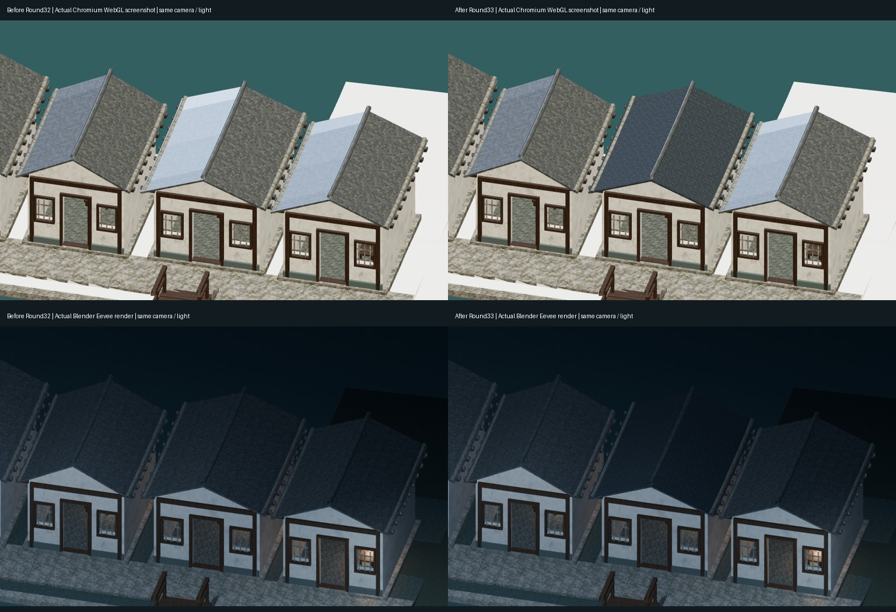
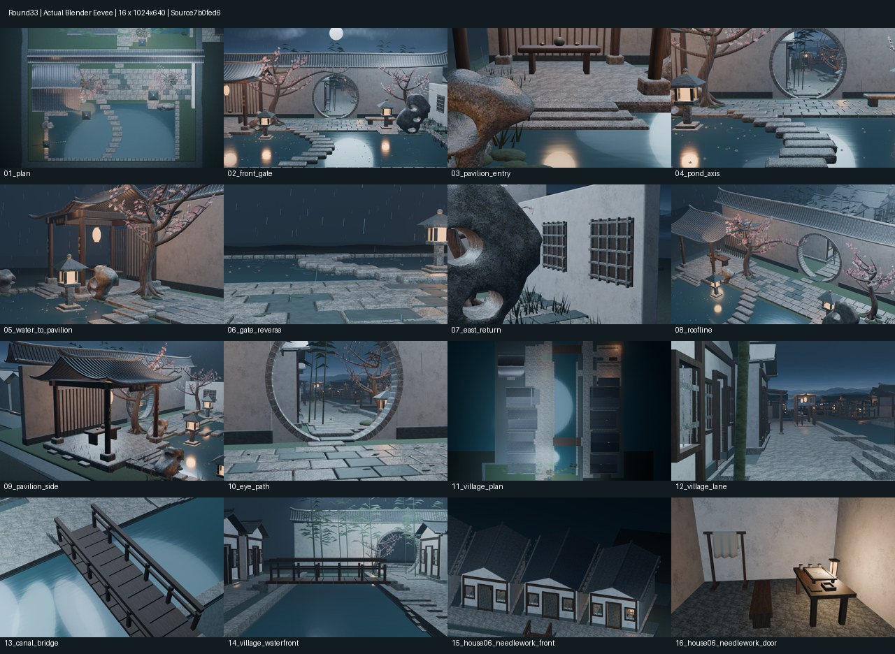

# Round33｜第6户黛瓦 PBR 小样审阅包

整体仓库 XDHRY/yanyu-jiangnan；独立客栈仓库未改。
源 commit：7b0fed6c5f7a65984005eb196ae9c5deffb3cf21。
PR：https://github.com/XDHRY/yanyu-jiangnan/pull/39
已合并27e2043582f51d406e16c565d8b122cc894d8e21，与测试合并bdc3cff156ef1d4a833072a087e96066fb1436ec的Git tree完全一致。

## 看什么

- round33-before-after.jpg：左侧旧 Round32，右侧本轮；上排真实 Chromium WebGL 截图，下排真实 Blender Eevee。相同机位与照明，无概念图。
- round33-contactsheet.jpg：本轮全部16个低成本 Blender 机位，原图长边1024。
- diagnostics/：16张原图与相机清单。
- runtime-audit/：桌面及移动尺寸浏览器截图与相机审计；软件渲染不等于实体手机测试。
- Jiangnan.blend：包含贴图的可编辑模型；jiangnan-town-standalone.html 为独立浏览器审阅文件。
- textures/：本轮两张256×256原始数据贴图；performance.json 与 validation/ 为实际导出预算及断言。
- provenance.json：逐文件 SHA256、源 commit、测试合并 commit 与 Actions run。

## 资产与边界

仅第6户既有屋面隔离一个 Mesh 副本、新增一种材质。屋面15顶点/8四边面、7厘米厚度与现有屋脊、檐下承托保留，不增加几何。原七张底图复用。

roof06_normal.png 来自周期高度场解析导数，OpenGL 切线空间；不是底图冒充法线，也不是高低模烘焙。roof06_orm.png：R=1中性AO，G=粗糙度，B=0非金属。两图均256×256、Non-Color、0.6米周期；新增RGBA8估算0.5MiB。源码、映射、许可与生成公式在仓库 assets/architecture/house06-roof-pbr/。

## 验证追踪

- CI：https://github.com/XDHRY/yanyu-jiangnan/actions/runs/38983726889
- Smoke：https://github.com/XDHRY/yanyu-jiangnan/actions/runs/38983726999
- Spatial：https://github.com/XDHRY/yanyu-jiangnan/actions/runs/38983727101
- Web：https://github.com/XDHRY/yanyu-jiangnan/actions/runs/38983726795
- 旧图来源：Round32 Web run38965576491，源c22b6db66afad6d88e02606d8639fc1c757dabdf。

终版四项构建均通过。Smoke artifact12082028312、Spatial artifact12082153678、Web artifact12081723728。下载后独立相机/材质/预算检查通过，1519个带底图primitive有UV，1个primitive有真实独立切线法线图，底图法线混用0。四张浏览器实截遮罩透明度均0、页面错误0、位置误差0、最大角误差2.98e-8弧度。

实际4521对象、98208源多边形、48种源材质；实例源三角面165134、全场景GLB求值三角面627155（均未增长）。唯一Mesh副本+1、唯一源三角面+16。GLB52922328字节，属性/索引估算29792134字节不变；9张图片、RGBA8估算44554784字节/42.49MiB（新增0.5MiB，非实际GPU显存采样）。原七图哈希保留。Spatial16图310.77秒，Web16图152.08秒；负载差异不能当优化提速结论。

已审阅本轮完整拼图、15/16机位与桌面/竖屏实截：第6户亮白镜面高光减弱，黛灰哑面与邻屋区分；檐口/屋脊/支撑和通行不变。夜景屋面偏暗、瓦列细节不足、竖屏主体偏小仍待处理，不标为极致美术完成。

Function/Form/Runtime 人工批准仍 pending；正式LOD、碰撞导航、完整UV专项、高低模法线/AO烘焙、实体手机性能仍待完成。单屋面小样不代表全镇PBR完成。

中间构建0bd6178四项CI通过，但Web首张截图截到加载遮罩的CSS淡出，整幅图变暗，未用于最终对比。7b0fed6仅修正截图等待条件并记录loadingOverlayOpacity，不改模型、灯光或曝光；最终截图须确认该值小于0.001。

## 实图预览

左旧Round32、右本轮Round33；上排浏览器，下排Blender。

