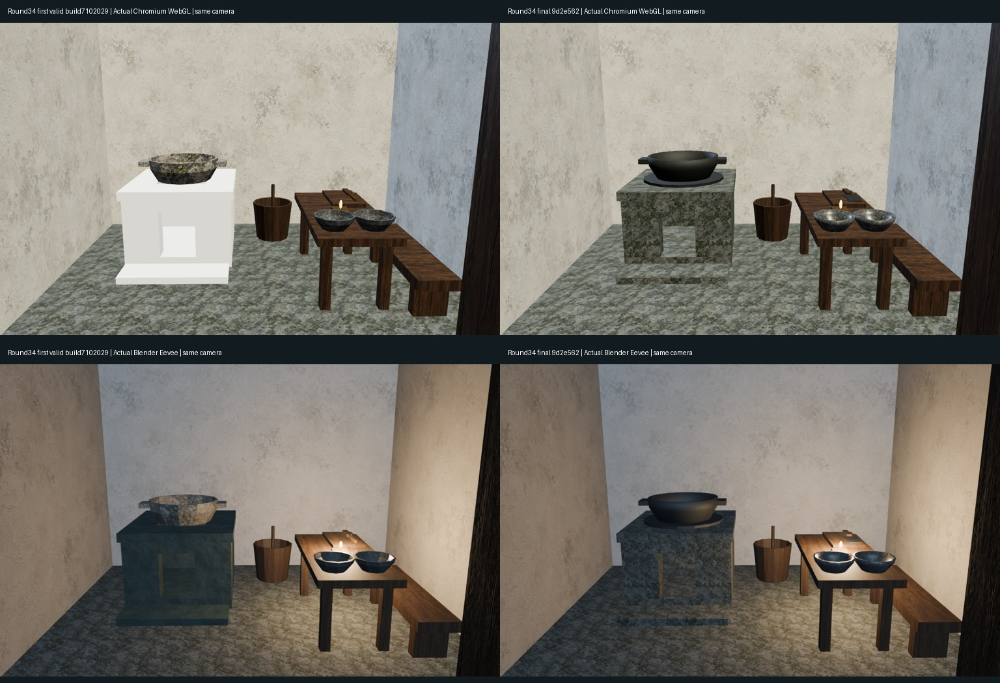
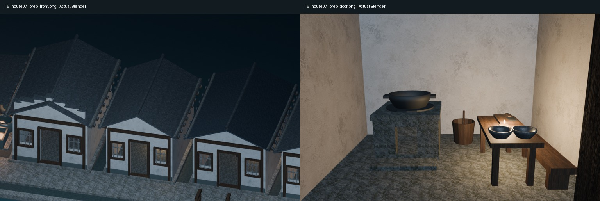
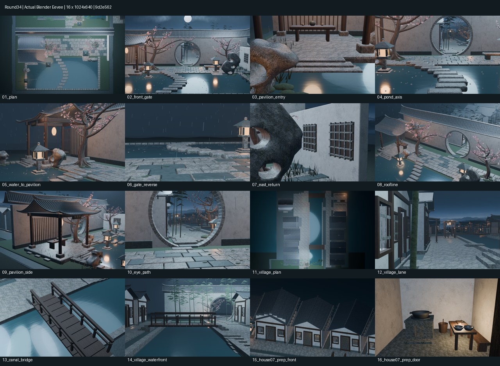

# Round34｜东岸第7户冷灶备膳节点

整体库XDHRY/yanyu-jiangnan；独立客栈仓库未改。源9d2e5625b7d9cbd5e2034ac9502b6e4e45334778，[PR40](https://github.com/XDHRY/yanyu-jiangnan/pull/40)。不是概念图或手工绕过源码的场景。

## 真实图像与模型

- round34-before-after.jpg：左为本轮首批有效实渲7102029（Spatial39090749177），右为终版9d2e562；具体相机一致性见performance.json。初始5ad9157因取景门限失败，没有审阅图，不作为左图。
- round34-focus.jpg：终版第15完整外景、第16门后近景。
- round34-contactsheet.jpg及diagnostics/：终版全部16个1024×640低成本机位，前14固定、15/16轮换至第7户。
- Jiangnan.blend：打包贴图的可编辑模型。
- jiangnan-town-standalone.html：单文件浏览器查看器，含GLB和640预览；原1024图在diagnostics/，不将缩略图当原图。
- runtime-audit/：4张Chromium/SwiftShader桌面与移动尺寸实截及相机检查，不是实体手机性能测试。
- performance.json、validation/、provenance.json：实际预算、支撑、材质、相机与逐文件来源哈希。

## 实际新增与修正

现有第7户内新增冷灶底座/侧背壁/灶口过梁、顶部孔洞、128三角面承锅圈、24段敞口铁锅和锅耳、砧板与扁平刀刃、两只共享16段碗、桶勺与灶前石踏。六类重复件共享Mesh。开启门扇后保留2.0×1.0米室内清空带，另核对门扇计入后的入口净宽；不把建筑门洞1.023米冒充实际可通行净宽。无新增壳体/屋面。旧油灯28→65以服务本户用途；首批有效版与终版之间不改灯光或曝光。

首批有效实图暴露灶体Web白化、铁锅继承石纹及刀刃像细条；终版新增2种局部材质，熟铁直接PBR（BaseColor .085/.095/.10，粗糙度.68，金属度.8，无底图），灶体隔离复制既有细磨青石节点（stone.png、线性乘色.45/.52/.54、粗糙度.82、源Bump .004m、1.8次/局部米）。原8户地坪使用范围不变。原图及许可沿用项目生成纹理，无外部新素材、新位图或付费服务；熟铁程序材质为本项目编写，未把方向光烘入BaseColor。

## 验证追踪

- [CI39091885335](https://github.com/XDHRY/yanyu-jiangnan/actions/runs/39091885335)
- [Smoke39091885331](https://github.com/XDHRY/yanyu-jiangnan/actions/runs/39091885331)
- [Spatial39091885353](https://github.com/XDHRY/yanyu-jiangnan/actions/runs/39091885353)
- [Web39091885332](https://github.com/XDHRY/yanyu-jiangnan/actions/runs/39091885332)

最终状态、实际源/求值三角面、9图哈希与相机误差以完整产物中的performance.json和来源记录为准，不把尚未完成的构建标作通过。

终版四项全部success；PR40已合并为41def5fb6d9095b6bcd8d7c6b736e23a2330c7c9，正式合并与测试合并65fc139完整Git树相同。Smoke artifact12123057805、Spatial artifact12122899048、Web artifact12123570675。

下载后独立复核：源4550对象/98760面/166342实例Mesh三角面（上限170000、余3658）、50材质；备膳24可见对象/1148三角面（上限1200）。GLB628311求值实例三角面、52973096字节、属性索引29827470字节；9图RGBA8估算44554784字节/42.49MiB，原9图哈希完全不变。1533个带底图primitive有UV，1个有独立法线图；16导出相机一致。环形锅圈焊接后每边两面/128三角面。4实截遮罩透明度均0、页面错误0。纹理和缓冲估算不是实测GPU驻留显存或帧率。

Spatial16图204.73秒，Web另一组16图312.18秒，长边1024；不把不同构建负载当提速。14固定相机与Round33逐项相同，前后对比Blender相机和网页姿态/投影/视口完全一致。实际保守门净宽0.939299米，门后2×1米带，3条入口射线通过。

## 未完成与边界

烟道未完成，冷灶没有火/烟效果，不能宣称可用灶房。下一轮优先解决排烟路径、穿墙/屋面真实开洞与防雨接缝，再讨论燃火效果；不能用烟囱穿过未开洞壳体。碗釉、木作细节、完整UV、正式LOD、碰撞导航和实体手机体验仍待专项。Function/Form/Runtime人工批准均pending，不发布生产场景。

通用房间技能的`validate_room.py --gate form`实际执行未通过：此项目增量资产目录缺少其7份标准房间包文件（brief、plan-metadata、props、layout、openings、milestone-reviews、final-report）。项目专项断言通过不能冒充通用Form门禁通过；本包仅为现有授权下的模型/诊断审阅产物。

## 实图预览

