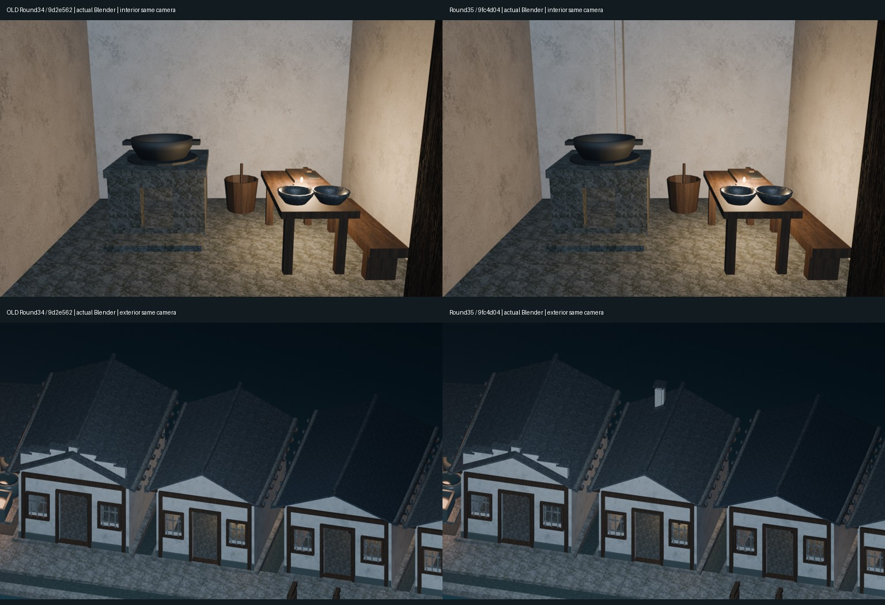
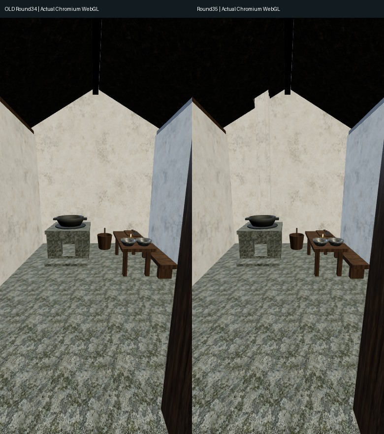
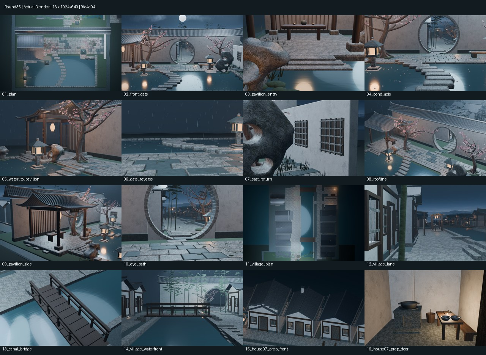

# Round35｜第7户冷灶排烟几何审阅

整体库XDHRY/yanyu-jiangnan，[PR41](https://github.com/XDHRY/yanyu-jiangnan/pull/41)。独立客栈库未改。基于Round34完整村镇，不回退旧main。

## 图像与模型

- round35-before-after.jpg：左为旧Round34源码9d2e562/Spatial39091885353，右为本轮。上排室内、下排外景；15纳入新烟囱后重新运行拟合，实测最终相机未变，16也未变，可作同机位对比。
- round35-mobile-comparison.jpg：旧Round34与本轮Chromium/SwiftShader移动尺寸实截；不是实体手机性能测试。
- round35-contactsheet.jpg及diagnostics/：本轮全部16张1024×640 Blender Eevee原图，前14固定。
- Jiangnan.blend：打包贴图的可编辑生成产物；jiangnan-town-standalone.html内含实际GLB与预览。
- validation/、performance.json和provenance.json：实际几何、预算、图像哈希与相机来源。

## 实际构造

新增13个可见低面构件：落地烟道承台、34厘米外宽/18厘米净腔烟道、顺坡泛水和上翻收口、四角支撑防雨帽。侧壁、帽撑两类共享Mesh。原灶后背壁开18×22厘米烟口；仅第7户屋面隔离副本，先应用原7厘米厚度再Exact Boolean开38厘米方洞，其他高脊屋面保持3顶共享。泛水逐角采样原求值坡面，覆盖洞边90毫米，搭接烟囱5毫米，非浮空平板。0新增材质、0位图、0付费、0新增民居。

首批0313677在灶后烟路断言失败，无有效审阅新图，未合并；旧box()面朝向不适合直接参与Exact差集。修订仅重算本轮刀具、目标及新构件外法线，保留其他共享资产；不放宽贯通或预算检查。完整过程见交接。

## 屋脊亮线与验收边界

终版源9fc4d0448c537fc873b24ff4548789771d35431b，测试合并290dc9f6c097aae2d1d14d51c4ad0ca2b6a38f6b；PR41已合并为7c48b118978bea4140865184e1754d4c1b80c774，测试与正式合并完整Git树完全相同。

- [CI39101524560](https://github.com/XDHRY/yanyu-jiangnan/actions/runs/39101524560)、[Smoke39101524602](https://github.com/XDHRY/yanyu-jiangnan/actions/runs/39101524602)、[Spatial39101524633](https://github.com/XDHRY/yanyu-jiangnan/actions/runs/39101524633)、[Web39101524539](https://github.com/XDHRY/yanyu-jiangnan/actions/runs/39101524539)全部success。
- Smoke artifact12126602042、Spatial artifact12127400448、Web artifact12126539369。下载及内包CRC通过，实际GLB16相机/材质/预算独立检查通过。
- 实测4563对象、98888面、166626源实例Mesh三角面（上限170000、余3374），50材质、9图；原备膳24可见构件1168/1200，烟道13新构件196/260。不同源/修改器求值口径不混用。
- GLB628555求值实例三角面、52993188字节、属性索引29839822字节；较Round34分别+244三角面/+20092字节/+12352字节。原9图哈希全部不变，RGBA8估算44554784字节/42.49MiB，不是实际GPU驻留显存或帧率。
- 1542个底图primitive有UV，1个有独立切线法线图；导出屋面与13新构件焊接边均2面、签名体积正。6段导出烟路射线全部贯通；Blender另外9孔口射线、原入口/门后通道/支撑通过。4网页实截遮罩透明度0、页面错误0。
- Spatial16图313.31秒，Web另16图312.17秒；全部16相机与旧Round34逐项一致，灯光曝光不改，不能把不同构建耗时当优化提速。

先看旧Round34 mobile16，再检查真实GLB：第7户旧屋面56三角面、焊接每边2面，亮线附近48像素射线全部命中本户承檩/屋面/山墙而非天空。因此没有将其误报为确认的通天洞，也没有宣称图形细线已经修复。

本轮只验证冷态几何，不证明抽力、热工、可燃物间距或消防合规；不添加火、烟，不声称功能灶房完成。补齐7份标准房间记录草案，但build-3d-game-rooms通用Form校验仍失败：完整工程图/人工审批未齐，而且该验证器要求Meshy图生模型和付费预算、仅支持门窗/壁龛，不能将零付费程序烟道自动判为通过。保留原验证器，不伪造图生模型、审批、定价或门窗类型；完整失败日志见generic-form-validation.txt。专项机器通过不替代该门禁和人工Function/Form/Runtime。无生产发布。粗石纹、碗釉、完整UV、正式LOD、碰撞导航、实体手机仍待专项。

## 实图

