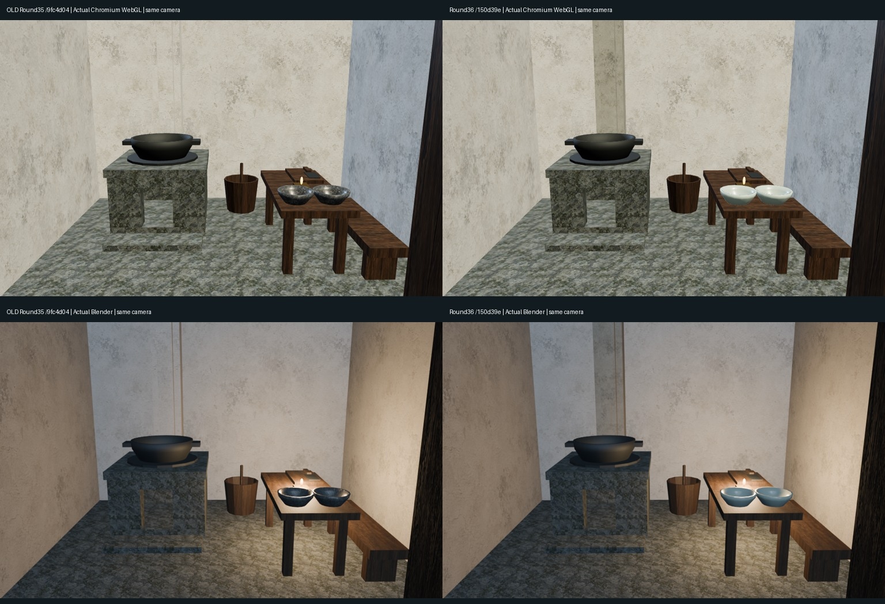
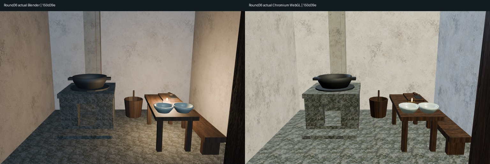
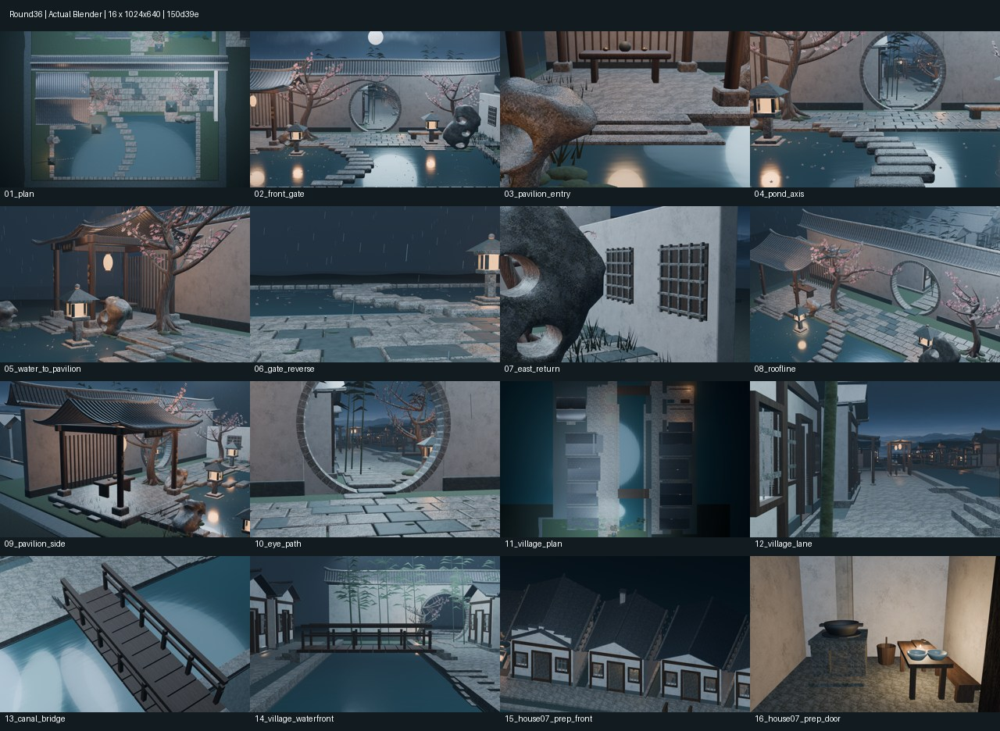

# Round36｜第7户法线、青白釉与灰面精修

整体库XDHRY/yanyu-jiangnan，[PR42](https://github.com/XDHRY/yanyu-jiangnan/pull/42)；独立客栈库未改。基于Round35完整村镇，不把旧图当本轮图。

源150d39eed91542960a741f909451de147ae1df9a，测试合并173ada9e3be0f8ebbd26d46083877ac22e8b5418；正式合并ea58984f65e8646af76b77baa48b8dc03ce64233，二者完整Git树相同c20376043a361b22b8466084c0ce56f3567e6d75。

## 实际验证与性能

四项通过：[CI39104593989](https://github.com/XDHRY/yanyu-jiangnan/actions/runs/39104593989)、[Smoke39104593990/artifact12127747867](https://github.com/XDHRY/yanyu-jiangnan/actions/runs/39104593990/artifacts/12127747867)、[Spatial39104594088/artifact12127134419](https://github.com/XDHRY/yanyu-jiangnan/actions/runs/39104594088/artifacts/12127134419)、[Web39104594062/artifact12128176596](https://github.com/XDHRY/yanyu-jiangnan/actions/runs/39104594062/artifacts/12128176596)。所有下载ZIP和Web内部ZIP CRC通过。

4563对象、52材质；源Mesh实例三角面166626/170000余3374。GLB628555求值实例三角面、52992872字节、属性索引29836942字节；9图RGBA8估算44554784字节/42.49MiB，不是实测GPU驻留。Spatial16图314.46秒；Web另16图200.32秒。无预算放宽。

独立GLB比较：全场每个Mesh节点的局部坐标集合和三角面数相同（允许UV/法线拆点差异）；15个可见目标闭合构件签名体积全正。9张嵌入原图SHA全部保留；16诊断机位、4网页相机参数与旧Round35逐项一致。4网页实截页面错误0、加载遮罩透明度0；1541带底图primitive具UV，1个独立切线法线图，新增PBR实际导出检查通过。

已审完整拼图、同机位前后和移动尺寸实截：碗从粗石纹改浅青釉，烟道灰度更可辨；灶体和地面粗石纹、屋脊旧图形细线未解决。下一批转不同区域的生活功能或公共空间，不继续连续精修本户。

## 真实图像与模型

- round36-before-after.jpg：左旧Round35源码9fc4d04，右本轮；上排Chromium/SwiftShader网页实截，下排Blender，同相机/灯光/曝光。
- round36-focus.jpg：本轮Blender与网页重点近景。
- round36-contactsheet.jpg及diagnostics/：本轮全部16张1024×640低成本原图。
- Jiangnan.blend：打包贴图的可编辑生成产物；jiangnan-town-standalone.html内含实际GLB和预览。
- runtime-audit/与baseline-round35/：本轮4张网页实截及明确标旧轮的对照，不是实体手机测试。
- performance.json、validation/、provenance.json：实际预算、法线体积、图像哈希和来源。

## 实际改变

仅本户11个闭合方盒数据块审计，10个负体积才反转面序，保留顶点、边集、面数和所有共享用户；不改全镇box()。碗、锅与烟道布尔几何不改，两只碗仍共享Mesh。19Python+3Node本地回归通过，机器结果不等于美术验收。

新增2种局部材质、0新位图/对象/几何：青白釉为恒定非金属PBR，线性BaseColor(.48,.57,.50)、粗糙度.27、Coat .30/Coat Roughness .18，无屋瓦/石纹底图；烟道灰面隔离复用已有plaster.png，线性乘色(.56,.57,.53)、粗糙度.88、Object BOX .60次/局部米、Bump .002m/Strength .08。图像/许可沿用textures/generation_prompts.json；无外部或付费资产，没有方向光烘入底色。Web为dominant-face UV近似，完整UV/法线烘焙仍待专项。

## 验收边界

沿用house07-flue的brief/openings/layout与人工记录。通用build-3d-game-rooms Form验证仍未通过：完整工程图和人工审批未齐，通用Meshy/门窗型验证器也不能代替零付费程序构造契约。完整失败日志保留，不伪造批准、付费模型或新贴图。

保持无火无烟；热工/抽力/消防、人工Function/Form/Runtime、旧屋脊图形细线、全镇UV/Normal/AO、正式LOD、碰撞导航、实体手机仍未验收。本轮不增加屋面/民居/街区，不生产发布。

## 实图

