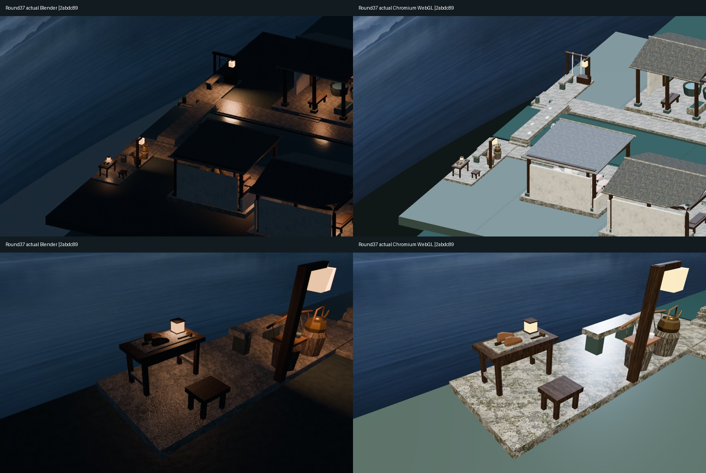
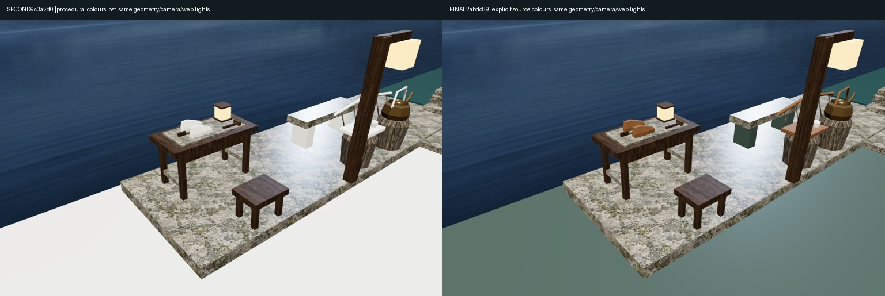
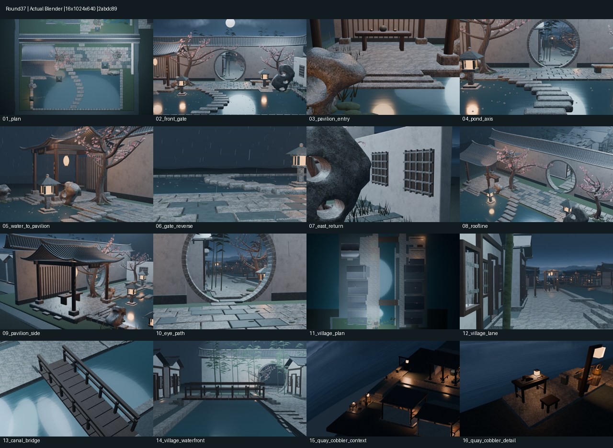

# Round37｜北河桥西补履歇脚摊

本包为真实 Blender / Web 渲染与可编辑模型，不含概念图。源 commit `2abdc89c41d063696b6aafde1f704a13bf00e597`；[PR43](https://github.com/XDHRY/yanyu-jiangnan/pull/43) 已合并为 `8b977674e9fe8296cb7aad72945527235a9d2ff3`。测试合并与实际合并树相同：`eceee829b6875a5cfa1f86953de70518fc0923b1`。

## 看图

首批查看实图后：木楦由方块改为三圈收分；锤头前移解决与灯座交叠；灯罩24厘米降18厘米，局部灯28W降18W。第二批实图发现Web原有程序暖木/深石材降级成白色，终批为这两种既有材质补源线性底色因子，Blender节点不变。第二批/终批对照的相机、几何、灯光相同；首批/终批不能声称灯具相同。

## 已实现与预算

- 与既有公共转水埠连接的石坪、四足补履案、撑枨、四足歇脚凳、工作板、两只共享Mesh木楦、锤、锥、纸案灯；25个可见Mesh，6组共享Mesh，1个局部18W灯；不新增房屋、屋顶或镇界。
- 4595对象、52材质、9图；源实例Mesh167094/170000三角面（新增468，含隐藏原型），余2906。实际GLB628919/629155三角面（新增364），**只余236**，后续加几何前必须优化。GLB53019040字节；贴图RGBA8估算42.49MiB，不是实测显存或FPS。
- Spatial16图160.68秒，Web16图154.06秒；保留14固定机位，15/16轮换，1024长边。旧Round36图不能冒充本轮。
- 独立GLB审计：25新实体闭合且正体积；8条案凳腿接触石坪和座面；锤灯净距0.122496米；全部旧网格局部坐标集合/面数/变换、9图SHA、14固定机位保留；仅两种目标材质因子改变。
- 第二/终批非UV二进制缓冲逐字节一致；724个UV bufferView存在最大2.288818359375e-5浮点漂移（审阅阈值3e-5），原因未归属，**不能宣称整个BIN相同**。

## 验证、产物和待办

终批四项成功：[CI39113501999](https://github.com/XDHRY/yanyu-jiangnan/actions/runs/39113501999)、[Smoke39113501997](https://github.com/XDHRY/yanyu-jiangnan/actions/runs/39113501997)、[Spatial39113502019](https://github.com/XDHRY/yanyu-jiangnan/actions/runs/39113502019)、[Web39113502028](https://github.com/XDHRY/yanyu-jiangnan/actions/runs/39113502028)。artifact依次Smoke12131097352、Spatial12132065444、Web12131796636；下载ZIP/内包CRC通过。合并后CI39128199975及Smoke39128200093成功，未重复dispatch。

本地20 Python与3 Node回归通过。4个桌面/移动视口真实浏览器截图无浏览器错误、加载层消失、姿态误差<1e-5；不是实体手机验收。通用Form实际失败，完整日志随包；工程图/完整UV与LOD/碰撞导航/Function、Form、Runtime人工批准仍pending，专项检查不替代正式门禁；不生产发布。无付费生成、0新材质、0新图片，独立客栈库未改。

木楦仍略显低面，夜间细部偏暗，Web粗石和程序材质平色降级仍需精修。下一轮优先优化GLB几何预算，保留轮廓、支撑和旧区域；然后修复局部纹理尺度与PBR映射。不得退回缺村落旧main，不恢复36机位，不盲目密集加物。

纹理仅复用仓库既有9图，来源提示词在textures/generation_prompts.json；提示词档案不是独立再分发许可，未发现独立LICENSE文件，本包不新增第三方资产许可承诺。素材来源与映射沿用既有manifest。

ZIP内有16原图、Blender文件、独立Web HTML、4个真实运行截图、第二批对照截图、统计/相机/材质/预算报告、逐文件SHA256 provenance和验证脚本；源码以Git为准。
