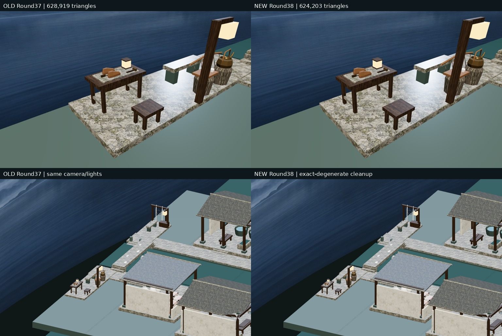
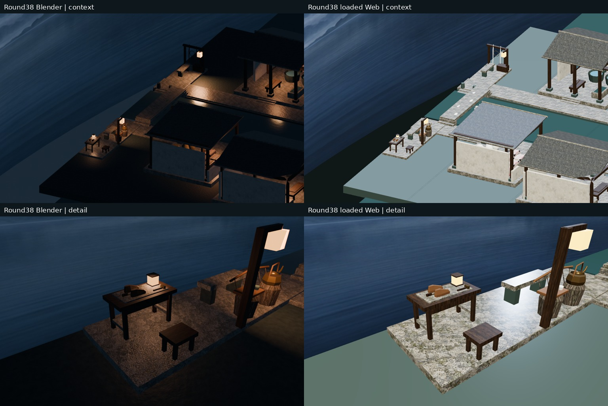
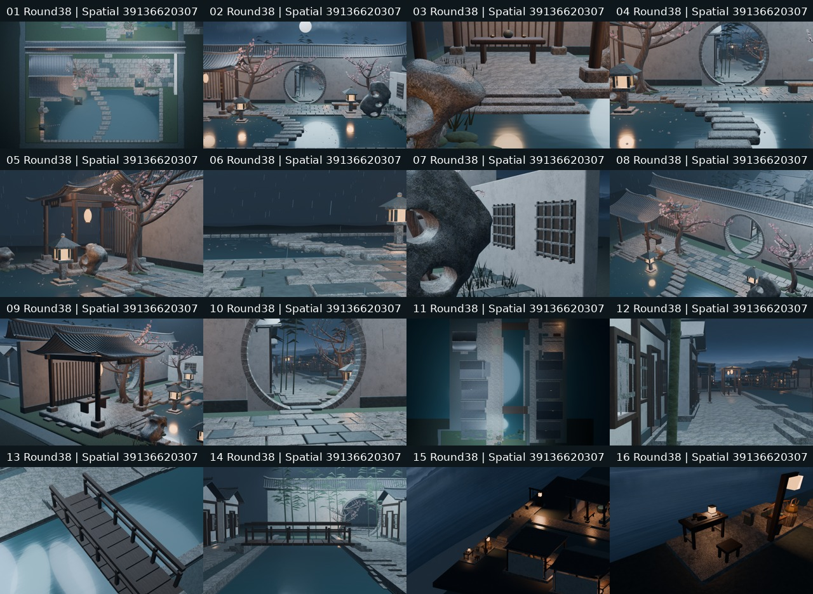

# Round38｜导出退化面预算优化

源commit `8bfa97e81031374d52c61b36f0a0c427bef08917`；测试合并commit `fe3b96da3e0056e125866de16ece78478def0343`；[PR44](https://github.com/XDHRY/yanyu-jiangnan/pull/44)。完整基线main `2c4e2c92e1291f12fb4fed44f0f3af2dac348fd7`，包含此前所有村落。客栈独立库未改。

本轮没有新增建筑、陈设、材质或图片。只在可复现导出链中删除POSITION完全重合、没有可见面积的三角形；不设epsilon，不近似删小面，不用Decimate，不移动顶点或改变UV/法线。共享索引要求所有使用者均退化。原Blender可编辑源及现有支撑、门洞、屋面、驱动和天气均不改。

## 真实图像

旧图明确标为Round37（Web run39113502028/artifact12131796636）。新图来自本轮Spatial39136620307与Web39136620220，非概念图；不把几乎不变的外观说成美术升级。

## 预算与证据

25个Python及3个Node回归通过。源Mesh仍167094/170000三角面，余2906；4595对象、52材质、9图，RGBA8纹理44554784字节/42.49MiB估算，不是实测GPU显存/FPS。本轮不降低源Mesh三角面，也不声称渲染加速。

GLB目标628919→624203三角面，删除4716（约0.75%），629155上限不变，余量236→4952；实际构建测量及审计见web/web-budget.json、web/topology-audit.json、independent-audit.json。微小正面积三角形保留；剔除索引后非目标属性/图片缓冲原字节保留。跨轮重建若有UV浮点差异，单独按实测报告，不归因于清理器。

四项验证链接：[CI39136620309](https://github.com/XDHRY/yanyu-jiangnan/actions/runs/39136620309)、[Smoke39136620334](https://github.com/XDHRY/yanyu-jiangnan/actions/runs/39136620334)、[Spatial39136620307](https://github.com/XDHRY/yanyu-jiangnan/actions/runs/39136620307)、[Web39136620220](https://github.com/XDHRY/yanyu-jiangnan/actions/runs/39136620220)。最终实际状态、artifact、合并记录和运行耗时见source.json及交接终版；仅成功的真实产物进入交付包。

## 未完成

通用Form实际失败日志附后，Function/Form/Runtime人工批准仍pending，测试成功不是人工美术验收；不生产发布。完整UV/AO/正式LOD、碰撞导航、实体手机、屋脊细线、粗石与Web程序PBR，以及灶房热工/消防仍未验收。现阶段只是低成本诊断级别的小镇，尚未达到最终“极致精美”目标。

下一轮优先选公共生活节点的材质尺度与粗石精修；如需加几何，同时受源2906与GLB4952余量约束，不直接填满预算。复用原9图及其提示词档案，无付费生成、无新第三方资产；提示词不是独立再分发许可，不新增许可承诺。

审阅ZIP含16原图、可编辑Blend、独立Web HTML、4个真实浏览器捕获、旧Round37对照、逐文件哈希及审计报告。仓库代码以Git为准。

## 终版实测

PR44已合并为c920a3a822e8b8ed810ff782f0fe9ba043c36c09，测试/实际合并树均22ab115c5b72335162cb63be58f4851170a6a16c；上述四项构建全部成功，artifact及源SHA见source.json。实际GLB624203三角面、53015892字节、attribute/index29846158字节，实例余量4952；Spatial16图204.26秒，Web16图221.70秒。没有对耗时的因果加速承诺。

独立检查保留全部非退化三角形原顺序、2266个POSITION流与法线等非UV属性、9图SHA、节点/材质/16相机。跨轮736个UV accessor最大3.0517578125e-5，**略超上轮3e-5审阅记录阈值，未把该比较标为通过**。用本次未改属性和原索引还原清理前GLB，原SHA为fc6ca2d36373300eef2f8009273fdd1277de1d0e1d947ddb712c132f1f67e4b9；匹配实际导出记录，再重跑清理得到最终文件逐字节相同，证明本次清理器不改UV。未改变阈值，未归属跨轮浮点漂移根因，仍是需跟踪的可重复构建债务。

四个真实网页视口图最大RGB平均绝对差0.000281/255（非完全同像素），无浏览器错误，姿态误差<1e-5。真实图复看未见可见缺面或轮廓损伤，粗石与夜景暗部问题仍存在；成功不等于人工批准或实体手机验收。
