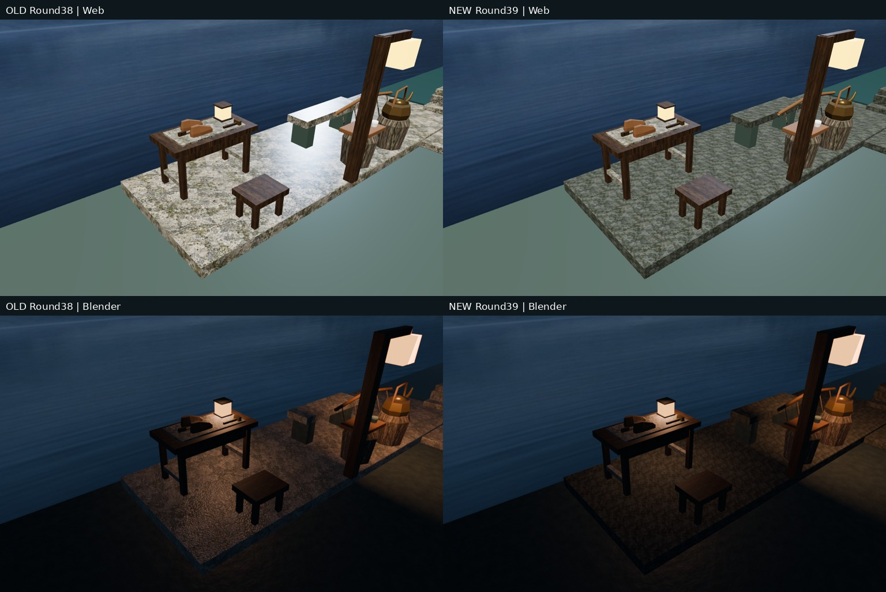
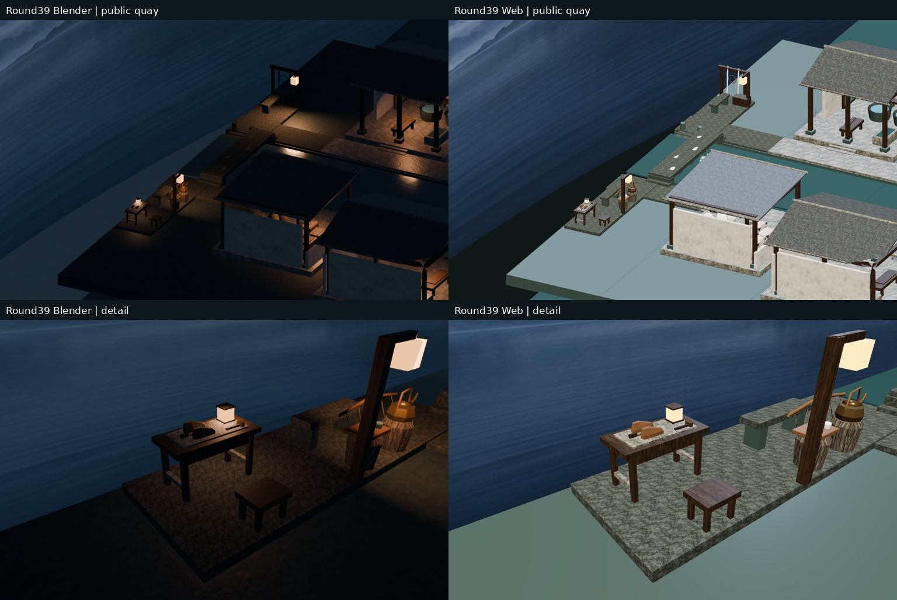
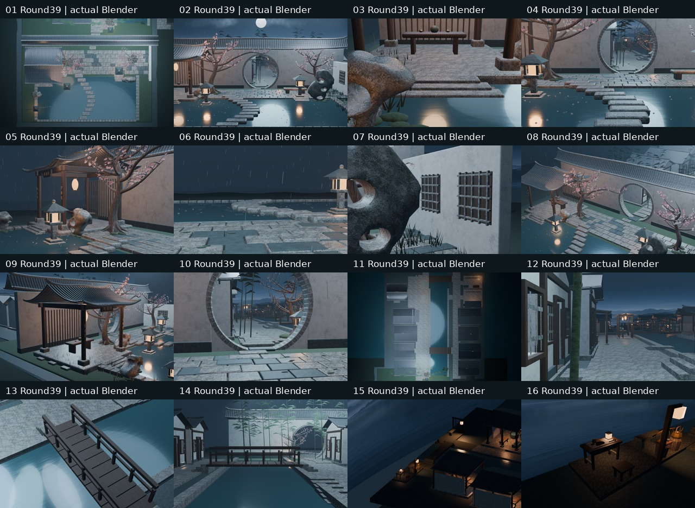

# Round39｜转水埠公共青石尺度精修

源commit `b10725c0b2a7280f899a7404f876811f5758e8a7`，测试合并 `7cf0be4bacd44808ef821f6f02ececd50128dfb8`；[PR45](https://github.com/XDHRY/yanyu-jiangnan/pull/45)。完整基线main8080e5022c1563b79fb90a23aaa227934cc84f49包含Round38及此前全部庭院/村镇。独立客栈库未修改。

## 实际修改

为既有公共水埠23个可见石材对象及2个隐藏共享原型建立1个局部共享材质：两岸石街、转身坪、9桥板、桥槛与亲水阶、2凳面和补履石坪。原桥板/石凳共享Mesh保留，不新增几何/陈设/房屋/位图。其他地区石材、地基、桥墩、凳足和木作不改。

原石材纹理.7次/米→2.4次/局部米（名义重复1.43米→.417米），凹凸距离.07米→.003米，强度.12，粗糙度.88、Specular IOR Level .20，局部底色乘(.36,.43,.45,1)。纹理仍复用既有stone.png，原图SHA不变；没有把原图斑驳去除，也不声称完整PBR/新法线烘焙。Blender近似Bump不支持Web，网页继续几何法线降级。

## 真实图像

左为旧Round38，右为本轮，机位、几何、灯光相同；上排网页实截，下排Blender：

本轮图来自Spatial39145650421与Web39145650395；旧图来自Round38 Web39136620220/artifact12139354654，明确标旧，不含概念图。14固定+2聚焦相机不改，长边1024，不恢复36机位。

## 验证与边界

本地27 Python+3 Node回归通过；四项链接：[CI39145650466](https://github.com/XDHRY/yanyu-jiangnan/actions/runs/39145650466)、[Smoke39145650356](https://github.com/XDHRY/yanyu-jiangnan/actions/runs/39145650356)、[Spatial39145650421](https://github.com/XDHRY/yanyu-jiangnan/actions/runs/39145650421)、[Web39145650395](https://github.com/XDHRY/yanyu-jiangnan/actions/runs/39145650395)。实际状态、artifact、合并与性能以source.json和终版交接为准，只有成功且复看的真实产物进入交付包。

源167094/170000三角面，原导出预算629155不放宽，9图RGBA8估算42.49MiB不是实测显存/FPS。跨轮非目标UV浮点漂移单独报告；23目标的UV尺度改变是有意修改，不混同不可重复构建。

通用Form在已有公共节点包上实际运行失败，日志随包；工程投影/Function/Form/Runtime人工批准、正式LOD/碰撞导航、实体手机仍pending。不生产发布、无付费生成。贴图来源见textures/generation_prompts.json及docs/art-direction.md；提示词不是独立再分发许可，本轮无新第三方资产或许可承诺。

纹理原图仍偏斑驳，完整UV/AO/切线法线、屋脊细线及灶房热工仍未验收；夜景明暗和整体材质层次仍需美术审阅。下一轮依据实图选另一已有公共/生活节点精修或预算允许的小批扩建，不继续无目的堆物。

## 终版结果

上述四项全部success，PR45已合并为7c5a1d44b8ba767a178f0816711cac8f15b4a0f2；测试/实际合并树相同9bf9941a708020bffa2498bbfc355d9c40683767。Smoke artifact12143620532、Spatial12143497113、Web12142823848已下载CRC验证，16空间图及4网页捕获已复看。

实际4595对象、53材质、167094源三角面，GLB624203三角面/53016464字节（比Round38仅增加572字节），attribute/index29846158字节、9图42.49MiB估算不变。16图耗时Spatial227.79秒、Web305.64秒；不承诺性能加速。源预算余2906，导出预算余4952，两者上限均未放宽。

独立实际GLB核对3092个几何节点的有向三角形、法线、变换均保持，恰23个可见对象换局部材质，原52材质与9图SHA保留，16相机全字段不变。非目标UV跨轮最大浮点漂移3.0517578125e-5仍作为可重复构建债务记录，不声称全BIN不变；目标UV纹理尺度是有意改变。独立camera/material/budget复跑通过，网页4视口无错误/姿态偏差<1e-5，加载遮罩消失；不是实体手机验收。

本轮改善是减小纹理颗粒和粗亮感，并未消除原图斑驳。未见新浮空、通道遮挡或屋檐—柱梁—台基缺损；原有暗部/粗石和全镇美术债务仍需持续推进。
