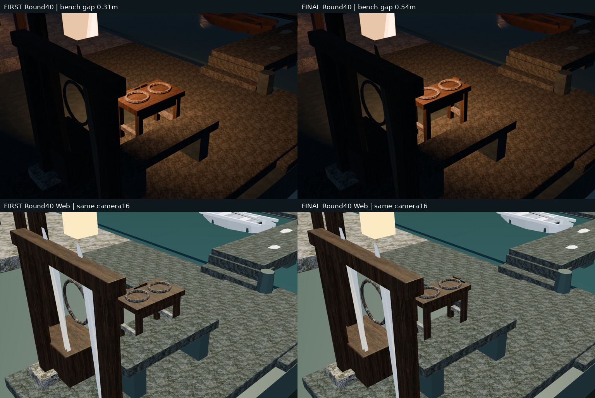
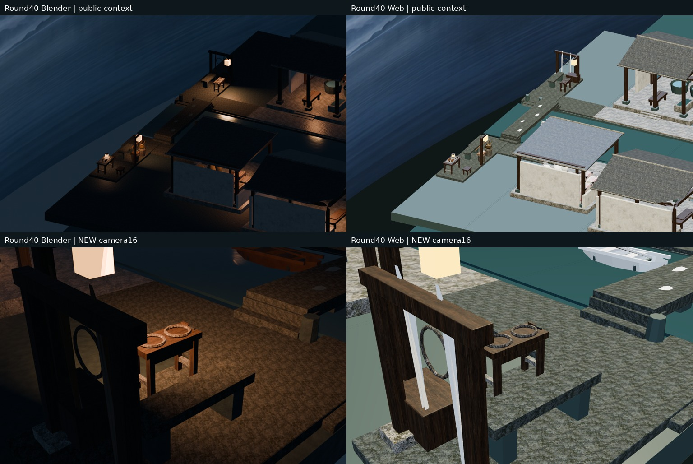
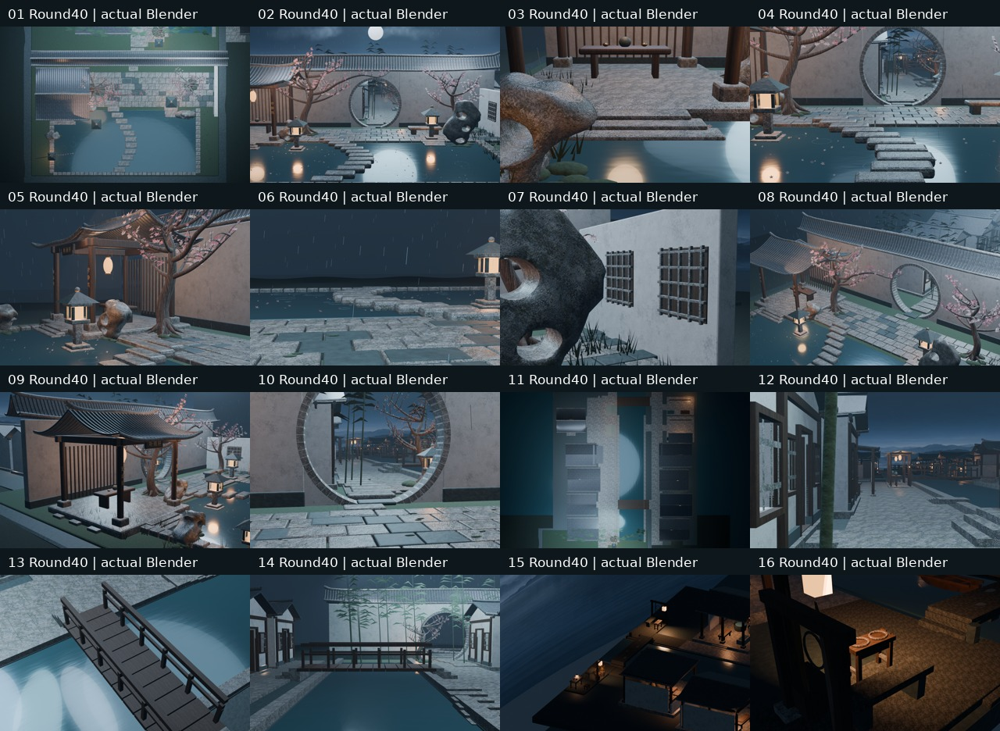

# Round40｜东岸缆绳整备案真实审阅

在既有转水埠东岸船具架旁新增13个可见Mesh及4隐藏共享原型：四足案、案牙、横枨、两只共享闭合待接绳环、木柄铁刃割绳刀。无新房屋/贴图/材质/灯光，独立客栈仓库未改；所有旧村镇保留。

源 `b6662718fc267e3d4da04a6793dfea3264c472f4`；测试合并 `b375b41b8ab88893923d8a68eaf65015a6253bf3`；[PR46](https://github.com/XDHRY/yanyu-jiangnan/pull/46) 实际合并 `a90d1634c467ee80c5da08588ff641aac9d76c86`；测试/实际树 `bee0443faa6e506cd5b17cc6ea65436235067cbf` 相同。

## 本轮真实图

左列是本轮首批7222ea86测试提交，右列是本轮终批；不是旧Round39同机位近景。案深56→40厘米、案前移15厘米，案与石凳净距约31→54厘米；相机16实际姿态、投影、镜头不变。上排Blender，下排实际Web捕获。旧Round39仅保留公共15作为有标记的历史证据，不冒充本轮。

## 验证与预算

- [CI 39155730308](https://github.com/XDHRY/yanyu-jiangnan/actions/runs/39155730308)：success。
- [Smoke 39155730311](https://github.com/XDHRY/yanyu-jiangnan/actions/runs/39155730311)：success。
- [Spatial 39155730264](https://github.com/XDHRY/yanyu-jiangnan/actions/runs/39155730264)：success。
- [Web 39155730346](https://github.com/XDHRY/yanyu-jiangnan/actions/runs/39155730346)：success。

Smoke artifact 12146898060、Spatial 12146722672、Web 12146948497 及Web内包已下载CRC通过。本地29Python+3Node通过；终批16图1024×640及桌面/竖屏4实际Web捕获，非实体手机。

实测4612对象、3094Mesh、1427Curve、170950顶点、99554源面、53材质、46灯；源实例三角面167982/170000，导出624815/629155，GLB 53042104字节。9图RGBA8估算42.49MiB，非实测GPU显存或FPS。新增源888/可见导出612三角面，4共享族，不用细分。

Spatial16图302.96秒，Web构建内16图303.86秒。四足接.16米石坪及.74米案底；绳环、刀具接.82米案面。主街净距0.420米、石凳净距0.540米；案未侵入主街。新实体闭合/正体积、共享/支撑/刀具包含与柄刃接合断言通过。

独立GLB核对3092旧几何节点坐标、有向三角面、法线及变换保留，53材质及9图片哈希保留，14核心+15公共机位字段保留；新增13可见节点全部闭合正体积。非目标跨轮UV最大浮点漂移6.103515625e-05单独记录，不声称全BIN确定性通过。

## 范围、未完成与下一步

真实近景可见案与绳环，但左侧船具架仍有前景遮挡、木作暗部重、绳环仅低面静态形状，不是捻股/绳索物理精修；材质仍是已有贴图与程序降级，不宣称完整PBR。只16低成本机位，未恢复36正式渲染。

通用Form实际运行失败日志见generic-form-validation.txt（此前公共节点证据适配仍缺工程投影/功能与人工批准等），专项断言不替代人工Function/Form/Runtime。完整UV/AO/切线法线、正式LOD、碰撞导航、实体手机、屋脊细线、灶房热工继续pending；无付费生成/生产发布。

下一轮先读最新main/PR/Actions及本索引；源余2018、GLB余4340三角面，优先不同公共生活节点精修或预算回收，不盲目填满。不能回退未含村落的旧基线。

独立ZIP包含完整终批16原图、可编辑Blend、内嵌模型独立Web、4真实浏览器捕获、首批同机位对照、旧39标记对照、manifest、验证/预算/逐文件SHA。仓库代码未在ZIP重复保存；源码以Git完整父树为准。图像均为真实构建，无概念图。
