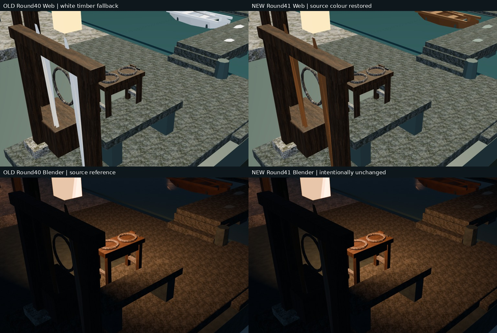
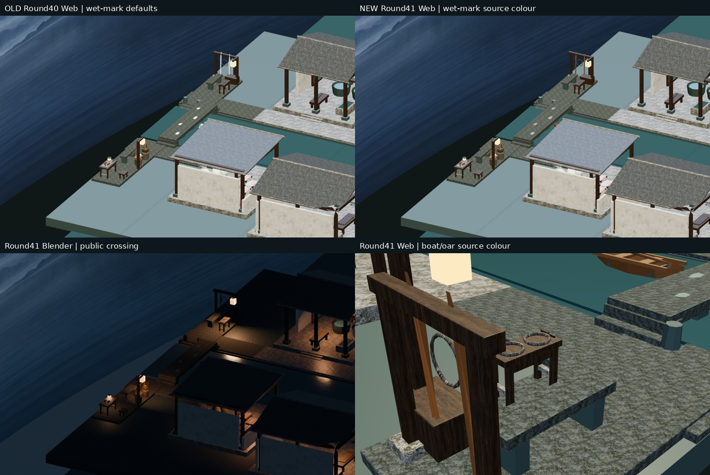
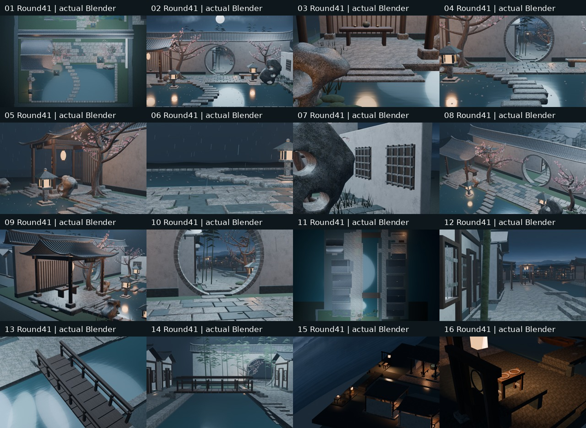

# Round41｜水埠船木与湿痕 Web 底色恢复

修复两种既有程序材质的导出默认白色：旧船木8可见用户（舢板壳、两舷条、两坐板及三船桨）与4块桥面湿痕。旧Blender程序Noise/ColorRamp源shader、几何、16相机、灯光不变；0新增几何/材质/位图。不是新建船只或完整PBR烘焙，独立客栈库未改。

源 `c09d781df3b2f78bc4f0da0fa3529ac71644729d`；测试 `069dea9849cb236445380d1561efd36b8a69f4c0`；[PR47](https://github.com/XDHRY/yanyu-jiangnan/pull/47) 实际合并 `28023275afb6b4c1ba97af4292f17a2efd32ec6e`；测试/实际树同为 `2ab75ac0590701c304600825f0f6a66ee0327af0`。

## 真实同机位前后对照

左旧Round40，右本轮Round41；上排实际Web截图、下排Blender原图。Blender前后保持是预期，不伪称源shader也被美化。右上船壳/船桨由默认白色恢复源色；不是贴图新增，也未隐藏前景船具架。

## 验证与实测

- [CI 39157207959](https://github.com/XDHRY/yanyu-jiangnan/actions/runs/39157207959)：success。
- [Smoke 39157208025](https://github.com/XDHRY/yanyu-jiangnan/actions/runs/39157208025)：success。
- [Spatial 39157208005](https://github.com/XDHRY/yanyu-jiangnan/actions/runs/39157208005)：success。
- [Web 39157208021](https://github.com/XDHRY/yanyu-jiangnan/actions/runs/39157208021)：success。

本地31Python+3Node通过。Smoke artifact 12148010054、Spatial 12147437405、Web 12148160014 及Web内包均CRC通过并核对GitHub所记ZIP SHA；16图1024×640及桌面/竖屏4Web捕获已复看，浏览器错误0、姿态/旋转误差<1e-5，非实体手机测试。

4612对象、3094Mesh、1427Curve、170950顶点、99554源面、53材质、46灯。源实例三角面167982/170000不变，GLB 624815/629155不变；GLB 53042448字节（旧53042104），attribute/index 29864814字节不变；9图RGBA8估算42.49MiB，不是GPU实测显存或FPS。Spatial16图171.80秒，Web构建内16图200.14秒，不声称加速。

独立核对3105几何节点：坐标、有向三角面、法线、变换、材质分配全保留；完整52个导出材质条目（48唯一名称）逐条核对，仅2材质baseColorFactor由默认白色改为源声明值，并新增对应的声明extras元数据，其余材质字段及9图片SHA保留，16实际机位保留。跨轮UV最大漂移6.103515625e-05，738节点有UV浮点差异，确定性仍pending，不说全BIN一致。旧真实GLB的适配器隔离测试二进制块逐字节不变。

## 限制与下轮

这里只恢复旧船木(.24,.105,.038,1)及湿石(.19,.25,.22,1)线性底色；粗糙度.55/.28与金属度0保持。Web未烘焙程序Noise/Bump，与Blender不是完整着色器等价。没有新来源或许可声明。

舢板仍为既有单层开放壳体，不假称封闭实体/可用舟船已验收。旧近景船具架遮挡、木作暗部、完整UV/Normal/AO、LOD、碰撞导航、实体手机、屋脊细线/灶房热工仍pending。通用Form实跑exit1缺标准工程审阅文件，见完整日志；专项CI不能替代人工Function/Form/Runtime，不付费生成、不生产发布。

下一轮先读最新main/PR/Actions及交接，优先已有资产结构厚度/支撑或实际近景遮挡；兼顾源余2018/导出余4340双预算，不用任意UV取整掩盖漂移。16低成本机位不扩为36，全部旧村镇保留。

独立ZIP含16终批原图、可编辑Blend、内嵌模型独立Web、4运行时捕获、明确标旧40对照、asset manifest、验证/预算与逐文件SHA。仓库已有代码不重复打包，源码以完整Git父树为准。无概念图。
