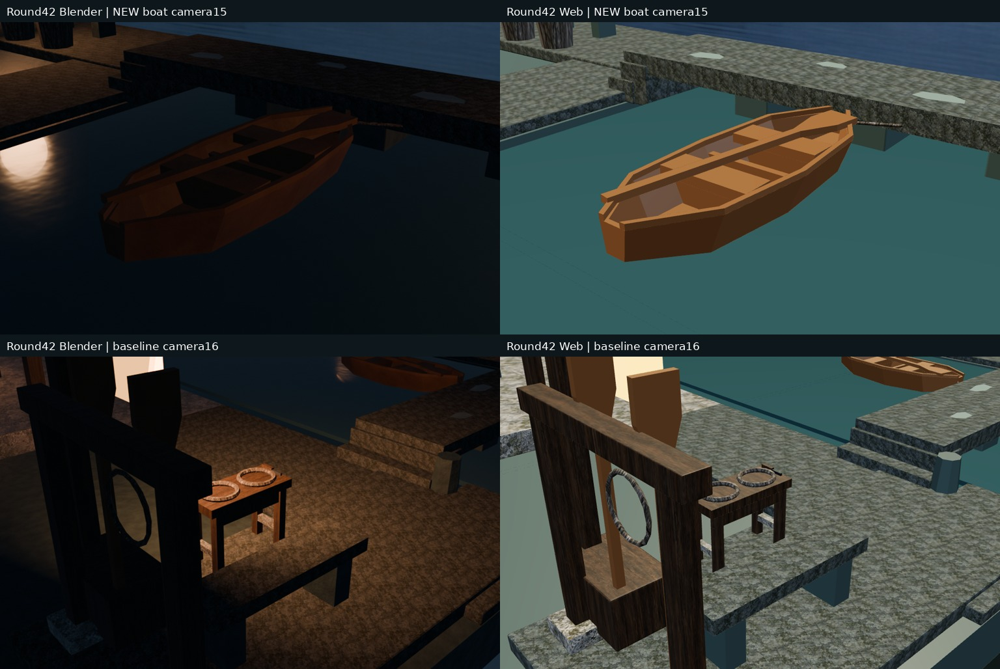
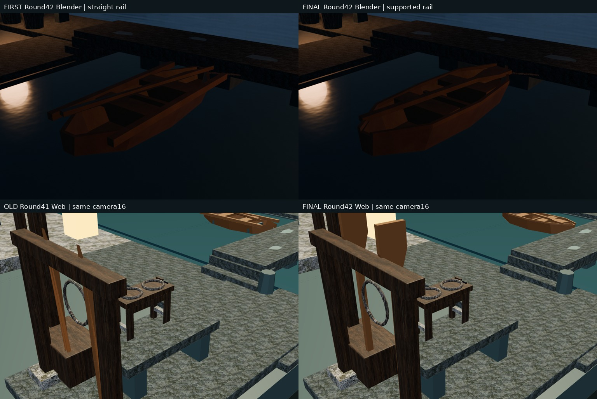
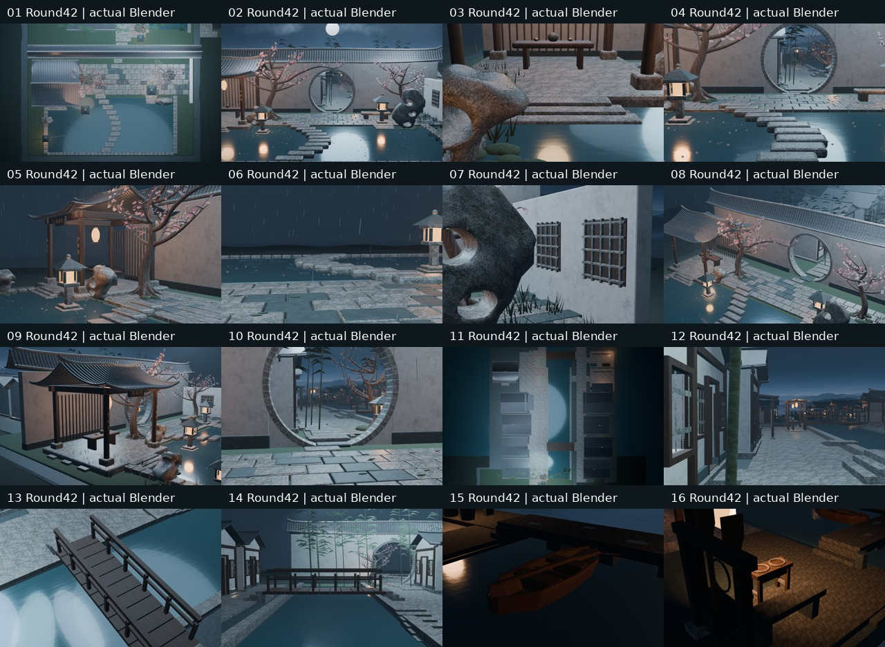

# Round42｜舢板实体壳与坐板支撑

源af09069cea57d1d5368410d9e965e3a077f8e86c；测试86fe79582f320d99ded8f23e6972e09ae7af639c；实际合并66e30acb8327e482ae9a10fb44c85422e239d8bd；测试/实际树993569b39c4ad5833a1a29d6b312c5f7378f1470相同。[PR48](https://github.com/XDHRY/yanyu-jiangnan/pull/48)。全部旧村镇保留，独立客栈库未改。

保留原20外侧顶点与14外面，增加35毫米轴向内缩的内壁/底及封边，舱口不加盖；船壳40顶点/38四边面/76三角面。三道同源梯形木肋底部接真实内底、顶面.455米，两道支撑原坐板；不再用石色横肋。首批实图定位旧直舷条悬出，后批补两条沿壳顶曲线的共享木舷条，36三角面/条，宽高4厘米。再将原自交桨形改16顶点/10面/28三角面的共享封闭桨，并降低舱内桨6厘米接坐板；架上两桨中心升至1.24米、柄端接.16米石坪，桨肩至架梁间距小于5毫米。总新增源184三角面（含隐藏原型），0新增对象/材质/贴图/灯，无付费生成。

第15机位为本轮新舢板近景，无旧41同机位前图。14核心+16保留。下图上排为首批/终批同机位15的Blender实图；下排左旧41/右本轮终批42为同机位16的真实Web，船只在背景，不替代15结构检查。首批Web因硬编码15投影类型而失败，没有首批有效Web对照，不冒充通过。

终批四项构建均success：[{'id': 39165684642, 'name': 'CI', 'conclusion': 'success', 'url': 'https://github.com/XDHRY/yanyu-jiangnan/actions/runs/39165684642'}, {'id': 39165684600, 'name': 'Blender 4.5 Scene Smoke', 'conclusion': 'success', 'url': 'https://github.com/XDHRY/yanyu-jiangnan/actions/runs/39165684600'}, {'id': 39165684604, 'name': 'Jiangnan Spatial Diagnostic', 'conclusion': 'success', 'url': 'https://github.com/XDHRY/yanyu-jiangnan/actions/runs/39165684604'}, {'id': 39165684602, 'name': 'Jiangnan Web 3D Viewer', 'conclusion': 'success', 'url': 'https://github.com/XDHRY/yanyu-jiangnan/actions/runs/39165684602'}]；artifact [{'id': 12150462780, 'name': 'Jiangnan-Blender-4.5-86fe79582f320d99ded8f23e6972e09ae7af639c', 'size_in_bytes': 23671424, 'url': 'https://api.github.com/repos/XDHRY/yanyu-jiangnan/actions/artifacts/12150462780', 'archive_download_url': 'https://api.github.com/repos/XDHRY/yanyu-jiangnan/actions/artifacts/12150462780/zip', 'expired': False, 'created_at': '2026-10-18T20:59:56Z', 'expires_at': '2026-10-25T20:59:55Z', 'updated_at': '2026-10-18T20:59:56Z', 'digest': 'sha256:2eefe9288d6ef82fd5db13ef383e293b662639b6591f788f68460c9c87ecbb0b', 'workflow_run': {'id': 39165684600, 'repository_id': 1374819141, 'head_repository_id': 1374819141, 'head_branch': 'codex/round42-sampan-shell', 'head_sha': 'af09069cea57d1d5368410d9e965e3a077f8e86c'}}, {'id': 12150487214, 'name': 'Jiangnan-Spatial-Diagnostics-86fe79582f320d99ded8f23e6972e09ae7af639c', 'size_in_bytes': 16237981, 'url': 'https://api.github.com/repos/XDHRY/yanyu-jiangnan/actions/artifacts/12150487214', 'archive_download_url': 'https://api.github.com/repos/XDHRY/yanyu-jiangnan/actions/artifacts/12150487214/zip', 'expired': False, 'created_at': '2026-10-18T21:04:56Z', 'expires_at': '2026-11-01T21:04:54Z', 'updated_at': '2026-10-18T21:04:56Z', 'digest': 'sha256:b1fa53768f1cc96069cb9b809e24451d9094ad15a373e03c546823c8e7a41967', 'workflow_run': {'id': 39165684604, 'repository_id': 1374819141, 'head_repository_id': 1374819141, 'head_branch': 'codex/round42-sampan-shell', 'head_sha': 'af09069cea57d1d5368410d9e965e3a077f8e86c'}}, {'id': 12149784900, 'name': 'Jiangnan-Web-Viewer-86fe79582f320d99ded8f23e6972e09ae7af639c', 'size_in_bytes': 120135992, 'url': 'https://api.github.com/repos/XDHRY/yanyu-jiangnan/actions/artifacts/12149784900', 'archive_download_url': 'https://api.github.com/repos/XDHRY/yanyu-jiangnan/actions/artifacts/12149784900/zip', 'expired': False, 'created_at': '2026-10-18T21:06:24Z', 'expires_at': '2026-11-17T21:06:23Z', 'updated_at': '2026-10-18T21:06:24Z', 'digest': 'sha256:434dbe696cb6565f879e040fbc0f27ef2be1ee3c09d9fc0420064b630b6b919d', 'workflow_run': {'id': 39165684602, 'repository_id': 1374819141, 'head_repository_id': 1374819141, 'head_branch': 'codex/round42-sampan-shell', 'head_sha': 'af09069cea57d1d5368410d9e965e3a077f8e86c'}}]。下载CRC及SHA256核对通过，Web内包CRC通过。38Python+3Node、BMesh封闭正体积、6条实际内底支撑射线、2坐板及2桨—坐板接触、2架桨接地与梁接触、空间/性能预算均通过，4真实桌面/竖屏Web捕获已审，非实体手机。首批失败记录见first-pass-web-failure.txt，修复后按manifest严格核对投影，未知类型仍拒绝。

实测4612对象、3094Mesh、1427Curve、171038顶点、99630源面、53材质、46灯。源实例168166/170000，GLB624959/629155，53047472字节。9图RGBA8估算42.49MiB，非GPU实测或FPS。Spatial16图300.97秒，Web内16图305.73秒，不声称加速。

独立审计3096非目标几何节点保持位置/有向三角面/法线/变换/材质，只有船壳、3木肋、2舷条、3共享桨改变；旧14船壳外面三角形保留。所有导出材质定义和9图片SHA保持，14核心+16相机字段保持；首/终批15实际姿态和投影也相同。非目标UV最大浮点漂移6.103515625e-05仍记录为pending，不说全BIN确定性通过。

应用build-3d-game-rooms厚度/支撑与真实证据流程；通用Form缺标准工程文件实跑失败，见日志，不等同人工Function/Form/Runtime批准。壳体为低面结构诊断，并非载荷/浮力/适航认证。完整UV/PBR烘焙、LOD、碰撞导航、实体手机、屋脊细线/灶房热工等仍pending；旧前景遮挡未通过藏物规避，不生产发布。

下一轮先读最新main/PR/Actions与交接，转向另一已有生活/公共节点精修或补齐结构证据；守源/导出双预算，保留本轮近景基线。ZIP含16本轮原图、可编辑Blend、内嵌模型独立Web、4捕获、明确标旧41对照、清单/验证/预算/逐文件SHA，无概念图。Git跟踪代码不重复打包。
