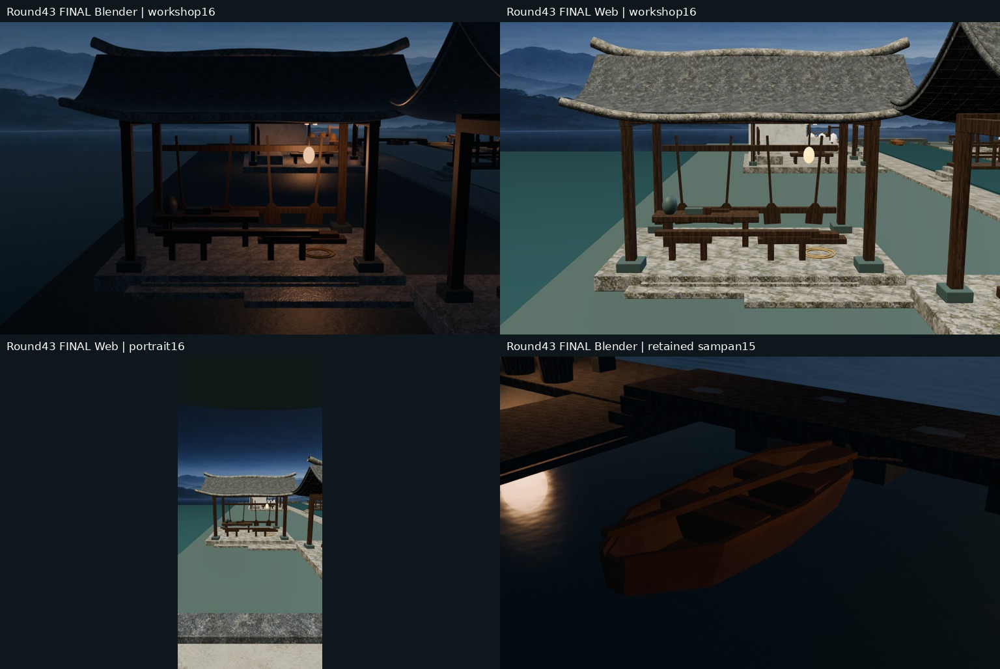
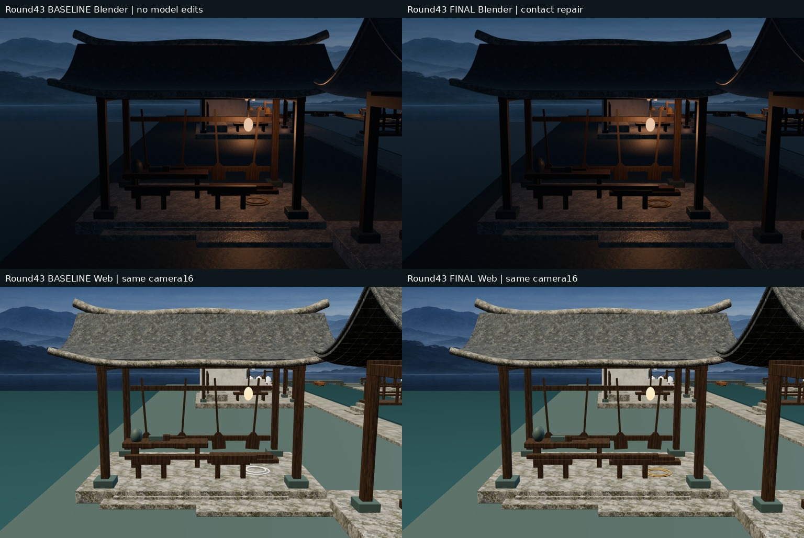
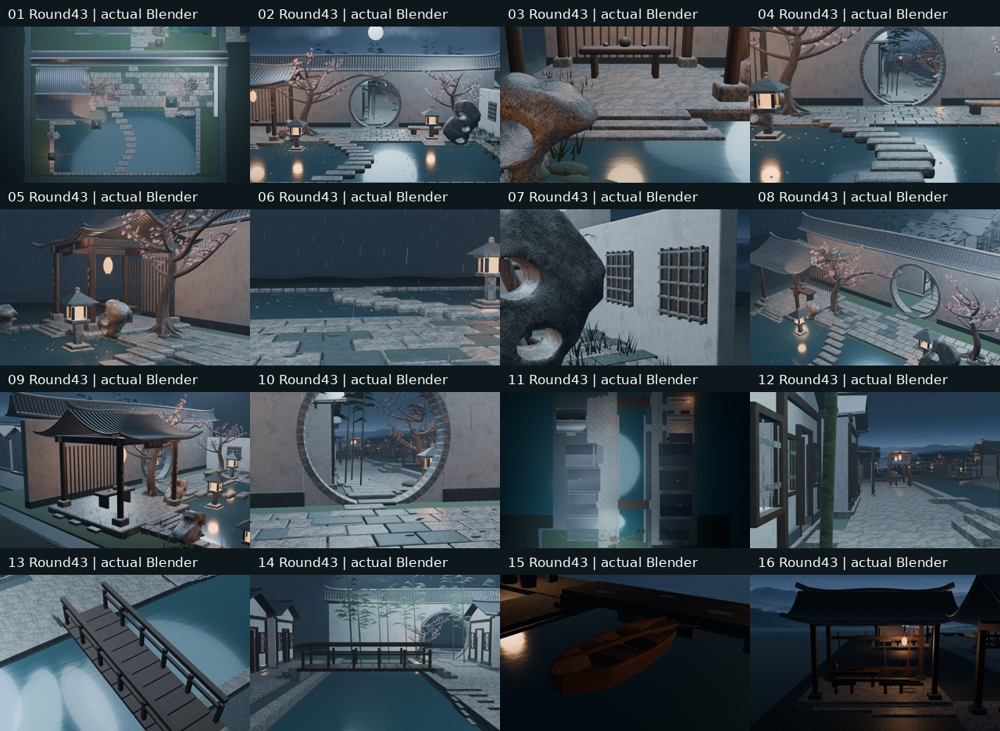

# Round43｜西岸修桨作坊落地工位支撑修复

源 86a3d2a3400ddd82c5490cf8b799e033d909aa06；测试 912d2e0370d228b0535d48083c54cab6e453ba45；实际合并 65dee16f9d572a194f3329e5907e3f7efffb3ba4；测试/实际树 e5fa5ce96b184364cbb5bd511c8fec7b9f0218d4 相同。[PR49](https://github.com/XDHRY/yanyu-jiangnan/pull/49)。基线main fe3456537358b7805c67e415d511d34dc010c526，全部村镇及Round42船具保留，独立客栈库未改。

本轮不是扩建新房。精修17个既有对象：4案腿、4马凳腿、桨坯、2船板、木刨、木槌头/柄、桐油罐和2盘绳。缩短埋入台基的腿，使上下端分别接台基/案面/横木；桨坯落横木、船板叠放接触；木刨/槌头落案、槌柄保持头内连接；油罐底改平面足、盘绳同平面落坪。0新对象/贴图/灯/三角面；新增1局部材质，复制原米行麻绳节点供两盘绳，保留Blender着色并恢复Web棕色，不改粮栈等其他用户。既有共享桨橹保持原高度与4实例关系；挂桨扣件/载荷仍pending。

两次相机草稿都在出图前因焦距过广被拒绝，没有有效前图。随后取得只改16相机、不改模型的有效基线，才修模型；失败日志见initial-camera-failure.txt。以下上排Blender、下排Web，均左为本轮有效基线、右为终版，实际16机位姿态/投影相同。全部14核心+15舢板保留，只有16轮换至作坊；旧Round42缆案16并非同机位对照。

最终四项构建success：[{'id': 39191737853, 'name': 'CI', 'conclusion': 'success', 'url': 'https://github.com/XDHRY/yanyu-jiangnan/actions/runs/39191737853'}, {'id': 39191737363, 'name': 'Blender 4.5 Scene Smoke', 'conclusion': 'success', 'url': 'https://github.com/XDHRY/yanyu-jiangnan/actions/runs/39191737363'}, {'id': 39191737356, 'name': 'Jiangnan Web 3D Viewer', 'conclusion': 'success', 'url': 'https://github.com/XDHRY/yanyu-jiangnan/actions/runs/39191737356'}, {'id': 39191737361, 'name': 'Jiangnan Spatial Diagnostic', 'conclusion': 'success', 'url': 'https://github.com/XDHRY/yanyu-jiangnan/actions/runs/39191737361'}]；artifact [{'id': 12160292741, 'name': 'Jiangnan-Blender-4.5-912d2e0370d228b0535d48083c54cab6e453ba45', 'size_in_bytes': 23675268, 'url': 'https://api.github.com/repos/XDHRY/yanyu-jiangnan/actions/artifacts/12160292741', 'archive_download_url': 'https://api.github.com/repos/XDHRY/yanyu-jiangnan/actions/artifacts/12160292741/zip', 'expired': False, 'created_at': '2026-10-19T02:51:01Z', 'expires_at': '2026-10-26T02:51:00Z', 'updated_at': '2026-10-19T02:51:01Z', 'digest': 'sha256:4635950f8a79d4ba5ae06e96a7edc269b32cecff3a8ef8328f367067d8ae4281', 'workflow_run': {'id': 39191737363, 'repository_id': 1374819141, 'head_repository_id': 1374819141, 'head_branch': 'codex/round43-workshop-support', 'head_sha': '86a3d2a3400ddd82c5490cf8b799e033d909aa06'}}, {'id': 12160671396, 'name': 'Jiangnan-Spatial-Diagnostics-912d2e0370d228b0535d48083c54cab6e453ba45', 'size_in_bytes': 16139337, 'url': 'https://api.github.com/repos/XDHRY/yanyu-jiangnan/actions/artifacts/12160671396', 'archive_download_url': 'https://api.github.com/repos/XDHRY/yanyu-jiangnan/actions/artifacts/12160671396/zip', 'expired': False, 'created_at': '2026-10-19T02:56:36Z', 'expires_at': '2026-11-02T02:56:34Z', 'updated_at': '2026-10-19T02:56:36Z', 'digest': 'sha256:92bb4fafaa8178d5522ad8c1dcfc8a0b4fb1269dbd4c6bbf28ed6d35b45af818', 'workflow_run': {'id': 39191737361, 'repository_id': 1374819141, 'head_repository_id': 1374819141, 'head_branch': 'codex/round43-workshop-support', 'head_sha': '86a3d2a3400ddd82c5490cf8b799e033d909aa06'}}, {'id': 12160148906, 'name': 'Jiangnan-Web-Viewer-912d2e0370d228b0535d48083c54cab6e453ba45', 'size_in_bytes': 119859328, 'url': 'https://api.github.com/repos/XDHRY/yanyu-jiangnan/actions/artifacts/12160148906', 'archive_download_url': 'https://api.github.com/repos/XDHRY/yanyu-jiangnan/actions/artifacts/12160148906/zip', 'expired': False, 'created_at': '2026-10-19T02:55:01Z', 'expires_at': '2026-11-18T02:54:59Z', 'updated_at': '2026-10-19T02:55:01Z', 'digest': 'sha256:9acea187a3eff21c96645595ce0f10a114f8a29caaf495de8a4e5812bbf128eb', 'workflow_run': {'id': 39191737356, 'repository_id': 1374819141, 'head_repository_id': 1374819141, 'head_branch': 'codex/round43-workshop-support', 'head_sha': '86a3d2a3400ddd82c5490cf8b799e033d909aa06'}}]。42Python+3Node本地通过；31条实际支撑射线、接触间隙<0.1毫米的数值容差检查及木槌头柄重叠检查通过；这是构造诊断，不是工程荷载认证。四个桌面/竖屏捕获零page error，姿态/旋转误差<1e-5，加载遮罩opacity<.001。实际GLB独立再查同一31处支撑；不是实体手机验收。

实测4612对象/3094Mesh/1427Curve，171038顶点、99630源面；源实例168166/170000，GLB624959/629155、53049640bytes。54源材质、9图、46灯；RGBA8纹理估算42.49MiB，非GPU显存/FPS实测。Spatial16图309.15秒，Web内16图166.03秒，不声称加速。

独立审计3088非目标几何节点的有向三角面、坐标/法线、变换和材质保持；原导出材质定义多重集和9图片SHA保持，仅新增两盘绳专用材质。17目标的三角面数量也未增加。非目标UV最大漂移6.103515625e-05继续pending，不宣称完整BIN或UV确定性通过。

沿用build-3d-game-rooms厚度/真实支撑/实图证据流程；通用Form实跑缺2文件且3旧schema不匹配，未通过。人工Function/Form/Runtime批准、正式LOD/碰撞导航、完整UV-PBR烘焙、夜景暗部、屋脊细线、灶房热工、挂桨固定与载荷仍pending；不生产发布，无付费生成。

下一轮先读最新main/PR/Actions与交接，按预算转另一生活节点或补挂桨可见扣件支撑；避免再堆本工位材质或盲加屋面。包内含终版16原图、可编辑Blend、独立Web、4真实捕获、明确标基线的16号对照、断言/预算/清单/逐文件SHA。Git源码不重复打包。
