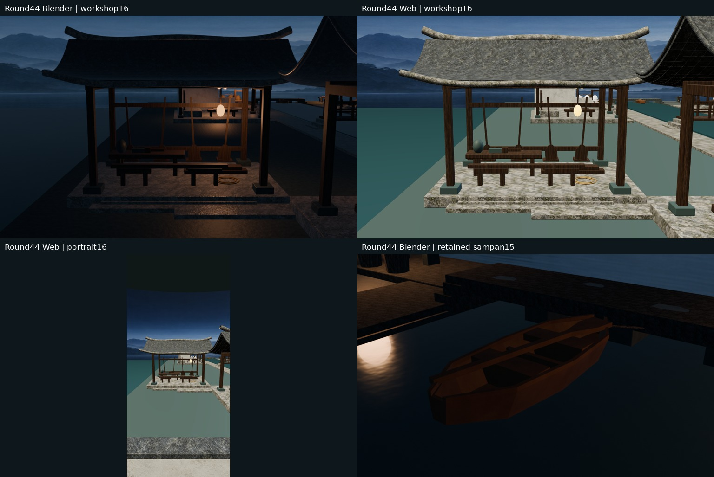
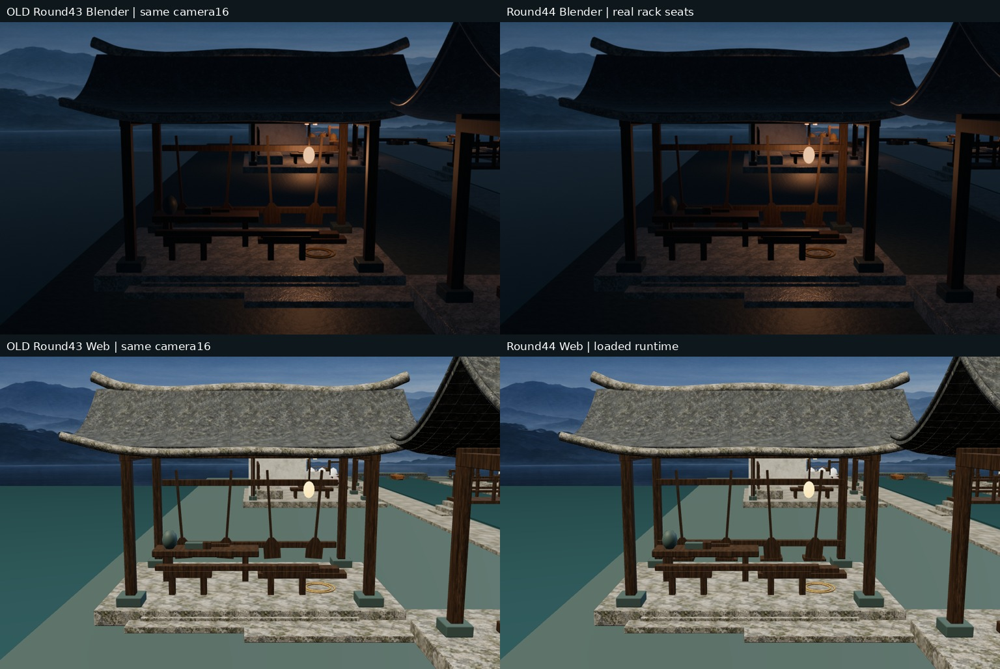
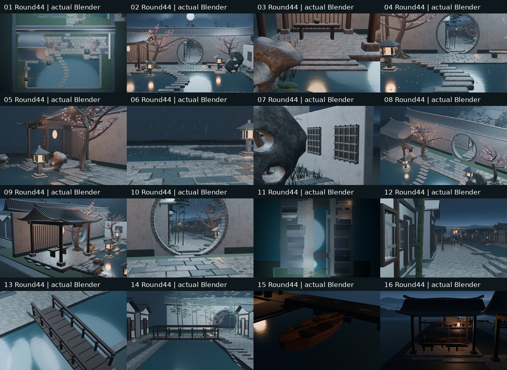

# Round44｜西岸修桨作坊共享腿与承桨架

PR50已合并：实际合并 `6073ba88e3809e5414f8b3c1250901326d32bc40`，与测试树同为 `ada0fad62ebbb58f895e9cc9de38f70838f915e0`。

独立审阅包 `yanyu_round44_workshop_rack_review.zip` 已保存：48文件、77528135字节，SHA256 `43e6fb42bd36d0364ae100f15a91c126fa2c26bedaabd9d1ff508a910760d1cd`。模型、16原图、HTML和验证齐备；不是概念图或生产发布。

源 commit：1ad5b3bfa71609e4ef893a34aca7908ada794e14；实际测试 merge：b1f5b08b1d5b1b01d0f7a6af37cc5528d8ff4200。
PR：https://github.com/XDHRY/yanyu-jiangnan/pull/50
Spatial run：39200883691；Web：39200883687；Smoke：39200883706。

8根旧腿共享为2个源Mesh；桨架2横枋接入后柱；4桨新增8个可见托座/背板、4组共享Mesh。
旧腿世界形状/尺寸保持；木纹1.1/1.1/0.30次每局部米保持，但同族采用共享纹理相位，不能称旧UV逐点保持。
未新增建筑、材质、图片或灯；桨本体形位保持。所有旧庭院和村镇保留，独立客栈库未改。

before-after.jpg：左为旧Round43真实图，右为本轮终版；上Blender，下Web，同一16号相机。
contact-sheet.jpg：本轮Spatial运行对应的16张真实Blender图，非概念图。
focus.jpg：Blender/Web/竖屏16和保留的15舢板；Web没有Blender天气灯光。

## 实际验证和预算

46 Python + 3 Node通过。旧31条真实支撑接触和4条罐底射线复验；本轮16条桨底四角落托射线、托背/枋柱交接检查通过。18个受改闭合对象的源/GLB体积为正，法线朝外；未全局改legacy box。
非目标3095几何节点、全部导出材质、9张内嵌图SHA及16相机字段保持。
非目标UV最大浮点漂移6.103515625e-05，确定性仍待验证。
对象4620，材质54，Mesh3102。
GLB三角面624959 → 625055；属性/索引29871174 → 29873670字节。
GLB大小53057484字节。9图RGBA8估算42.49MiB，非实测显存。
腿的源Mesh已共享，导出经倒角求值后的mesh项为8个；不能声称Web已实现2Mesh实例。该组属性/索引59832 → 55944字节。全场缓冲净变动必须与新支撑一起计算，不宣称全面下降。
16图耗时：Blender 166.05秒，Web 308.04秒；不同runner，不宣称帧率提升。

## 未完成与边界

通用Form实际失败，见generic-form.txt：缺标准文件且旧schema不匹配；机器检查不等于人工Function/Form/Runtime批准。
挂桨动力固定/载荷、夜景暗部、完整UV/PBR烘焙、正式LOD、碰撞导航和实体手机未验收，不生产发布或付费生成。
首批因旧历史基线未扣新增96面在断言阶段失败，没有有效图，见first-failure.txt；修正精确分项记账，所有预算上限保持。

## 文件

model/Jiangnan.blend：本轮源码重建的可编辑模型，贴图已打包。
renders/：16张1024×640原图及相机manifest；viewer/独立HTML；runtime/4张真实浏览器捕获。
baseline-round43/明确为旧图，仅用于同机位对照。
validation/机器报告；independent-audit.json独立实际GLB审计；SHA256SUMS.json逐文件散列。
Git追踪源码不重复打包。
