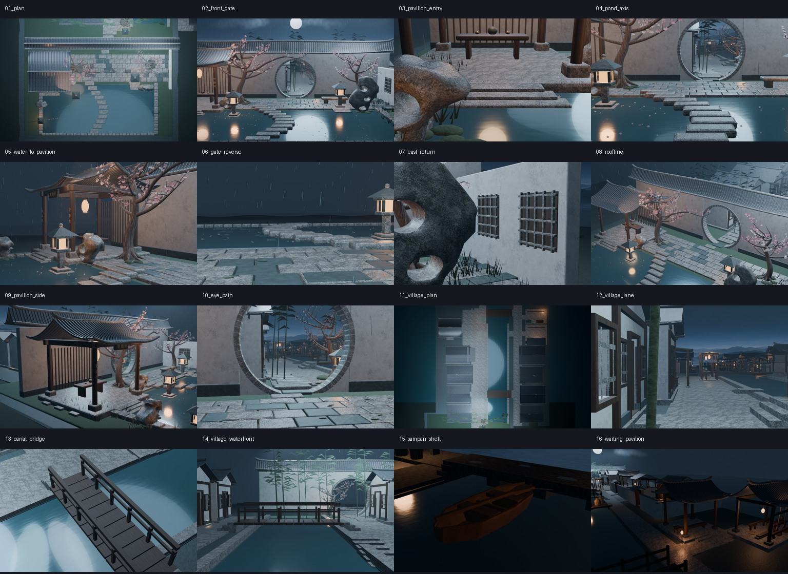
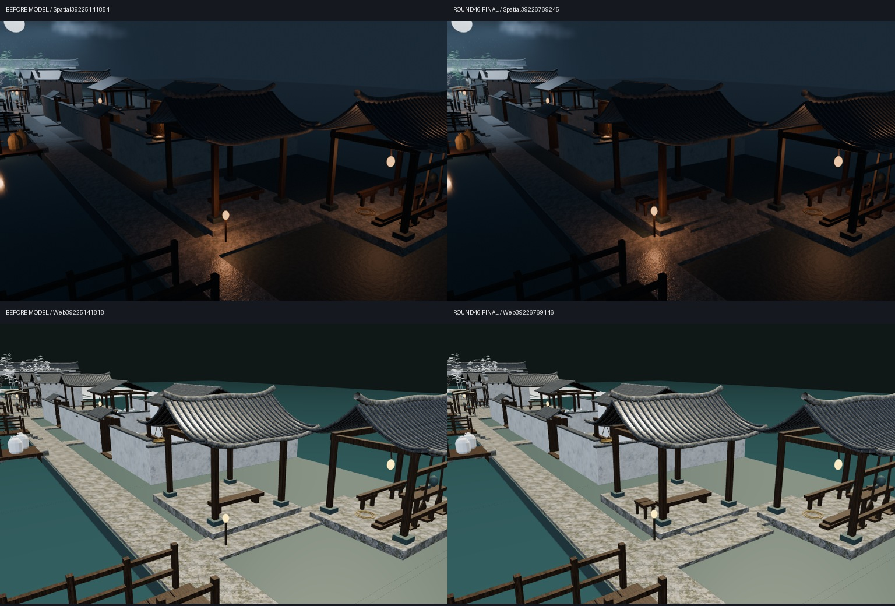
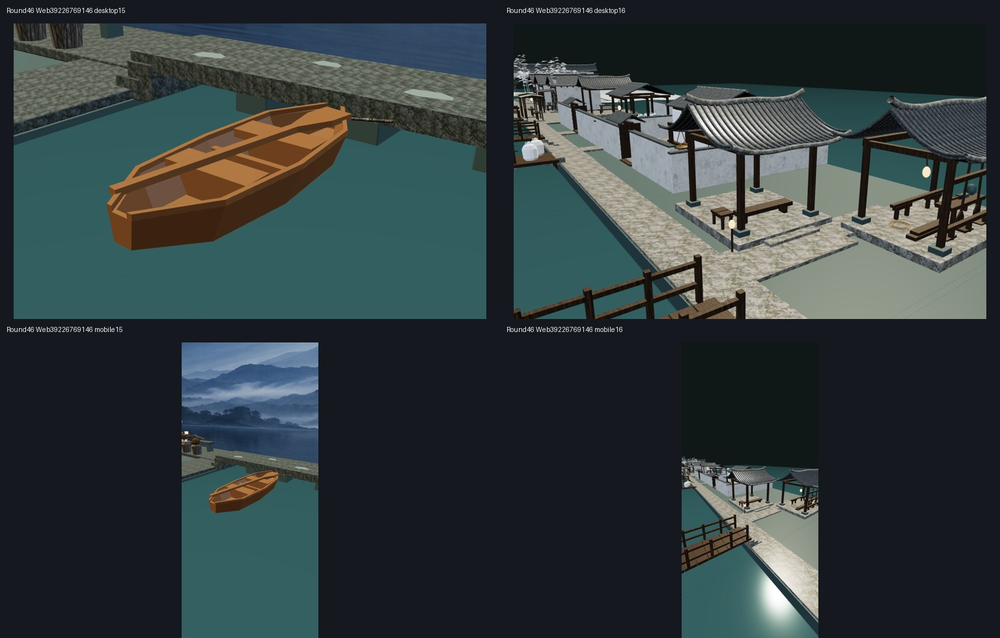

# Round46 候船亭—横巷实际审阅包

完整原图/可编辑模型/离线网页审阅ZIP已单独保存：yanyu_round46_waiting_pavilion_review.zip，166012387字节，SHA256 84017b1a28d22fade8c431db190cbdc260d3075f9bf2c12ef490987d918d82b1。Git图集只保留轻量拼图与复验脚本，ZIP内含50个文件及校验清单。

[最新交接](https://github.com/XDHRY/yanyu-jiangnan/blob/main/docs/iterations/20261019-waiting-pavilion.md)；[PR52](https://github.com/XDHRY/yanyu-jiangnan/pull/52)；[Spatial实际构建](https://github.com/XDHRY/yanyu-jiangnan/actions/runs/39226769245)；[Web实际构建](https://github.com/XDHRY/yanyu-jiangnan/actions/runs/39226769146)。网页南向天空背景覆盖缺失是既有待修项，不当作最终夜景。

源 1b4b69c418587c03ecb6df6ff5c624cfa3796b28；测试 c13fb90294e1fb0aeda2c59a05a6103e6b7e275c；实际合并 1dfe3a146c90c8062c98a07ecfbd8215da7cd071。
Spatial 39226769245；Web 39226769146；Smoke 39226769301。

基线为本轮后退后的相机批（模型尚未修改），不是第45轮作坊旧图。同机位新增1踏步和8个行李架构件、3共享架族；旧铺地连续扩宽2.646平方米、既有引路灯整组避让；无新建筑/材质/贴图/灯。首次构图图明确单列historical，仅为取景过程。

实测Web预算 {"instance_triangles": 625571, "glb_bytes": 53066256, "attribute_index_bytes": 29876166, "images": 9, "rgba8_bytes": 44554784}。RGBA8为估算，非实测显存/FPS。独立GLB支持/路线射线 29 条；保留非目标几何节点 3110。跨构建UV最大漂移 6.103515625e-05 仍pending，不宣称完整二进制确定性。

打开 Jiangnan.blend 可编辑；打开 jiangnan-town-standalone.html 可离线交互审阅。renders含本轮16张1024×640原图，runtime含4个实际Chromium/SwiftShader捕获，不是实体手机。before-model明确为本轮模型修改前。

尚未完成人工Function/Form/Runtime、标准Form证据、全镇PBR/UV/LOD/碰撞、实体手机、无障碍坡道与工程载荷。夜景仍偏暗；网页不含Blender全部灯光/天气，不能冒充最终夜景。独立客栈仓库未改，全部旧村镇保留，无36机位。

下一轮先核最新main/PR/Actions，选择不同连通节点或有证据的P0/P1修复，不在候船亭连续堆摆件，不放宽任何预算。
