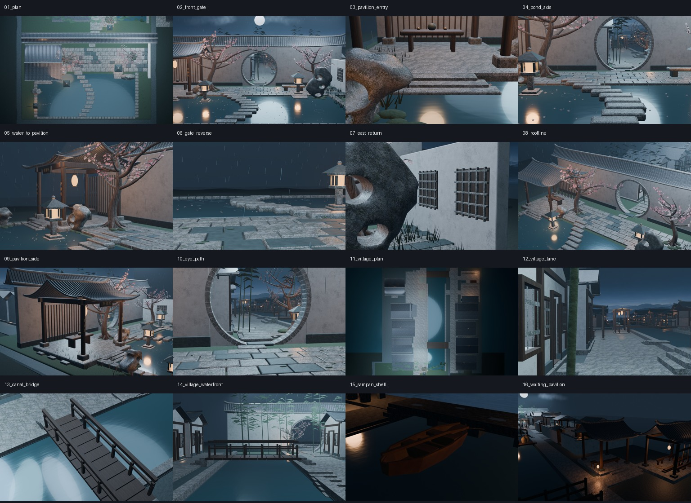
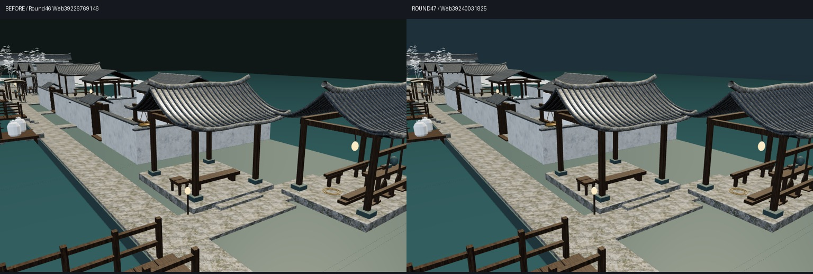
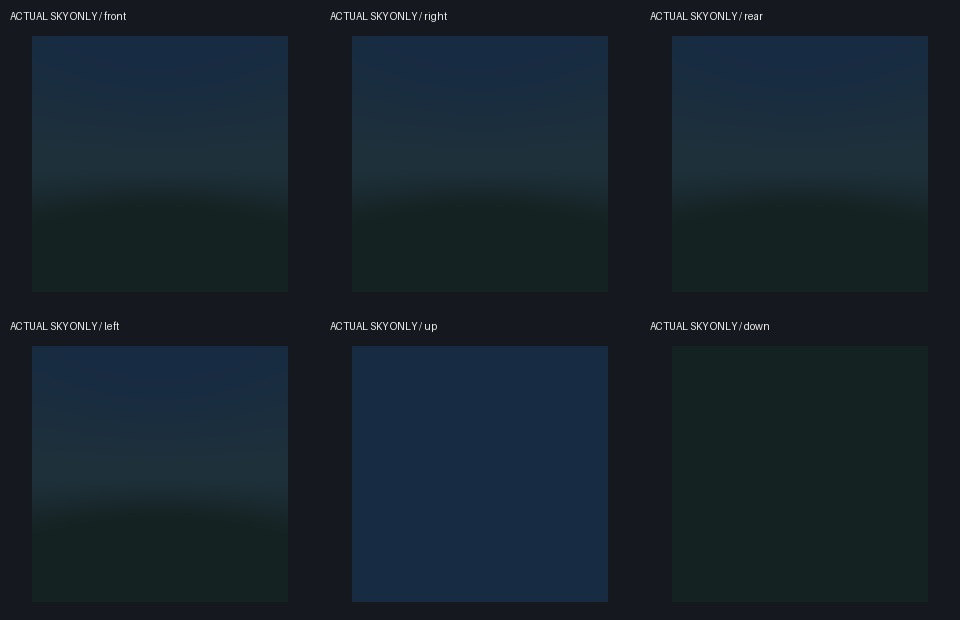
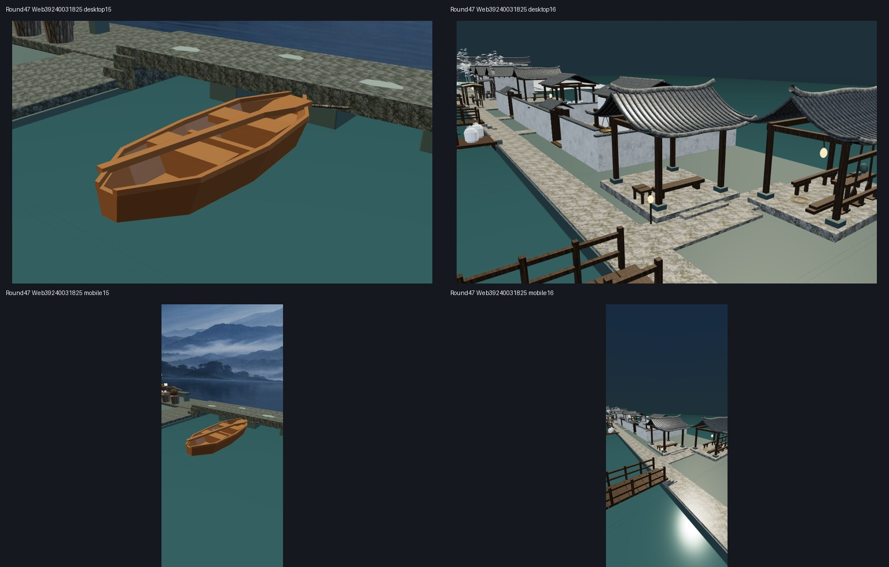

# Round47 网页天空底色覆盖实际审阅包

[PR53](https://github.com/XDHRY/yanyu-jiangnan/pull/53) · [实际Web构建39240031825](https://github.com/XDHRY/yanyu-jiangnan/actions/runs/39240031825) · [最新交接](https://github.com/XDHRY/yanyu-jiangnan/blob/main/docs/iterations/20261019-web-sky-coverage.md)

独立原图/可编辑模型/离线网页ZIP已保存：yanyu_round47_web_sky_review.zip，58文件、105571188字节，SHA256 7ce49920c48ced72bb962331afeed9758eeee6f75ae3c10523512eea83f4b82f。合并后CI39240913617及Smoke39240913622已通过。本分支仅保留轻量图集与审计，完整原图在独立ZIP。

源 141027e6bad40a6a81c696d8a3c13e44117bb9bc；测试 fa9d45d277cb895ddd7fa7e73fac6f977849d8d7；实际合并 ec761d06c036793cc201bc3febbee55ef02d596a。
CI 39240031866；Smoke 39240031816；Web 39240031825。

本轮只修复网页未覆盖方向的近黑底色。GLSL按实际视线方向提供克制天空渐变，不改原远山画片、全部村镇模型、16机位、源材质或9图。不是完整远山全景、HDRI、天气、月亮、IBL照明或最终夜景。没有新增建筑、建模构件或贴图。

新增运行时成本：1三角形/36字节position/1 shader材质/1预绘制pass；不是零GPU成本。实测GLB预算 {"instance_triangles": 625571, "glb_bytes": 53060668, "attribute_index_bytes": 29870982, "images": 9, "rgba8_bytes": 44554784}。RGBA8为估算，非实测显存/FPS。独立比较保留 3122 几何节点、16相机、旧材质及9图SHA，位置/法线最大差 0.0；跨构建UV最大漂移 6.103515625e-05，确定性仍pending。

六向实际256×256环境截图像素核验 393216 像素通过；runtime含4个真实Chromium/SwiftShader桌面/移动视口捕获，不是实体手机。before-round46明确为旧Round46，前后相机保持，源模型保持。renders含本轮Web构建实际重渲的16张1024×640 Blender原图，不是旧图；本轮改的是Web背景，Blender外观保持属于预期。

Jiangnan.blend可编辑；jiangnan-town-standalone.html离线交互审阅；GLB保留完整村镇。全套校验见checksums.json。

尚未完成人工Function/Form/Runtime、标准Form证据、全镇PBR/UV/LOD/碰撞、实体手机、无障碍坡道与工程载荷。夜景暗部、360度远山衔接与UV微漂移仍待修。独立客栈仓库未改，无付费服务、无36机位。

historical-first47-not-final 是本轮首批历史证据，不是终版：首批像素门禁通过，但复核发现六向首张视域不同，源码通用resize回调可重置FOV；当时未记录FOV，不把52度推断当作捕获事实。终版增加环境投影guard及90度/方形矩阵实际检查。source47.json记录两批commit/run及本地复现因缺Chromium而未运行，未伪造本地复现成功。

下一轮先核最新main/PR/Actions，优先123834字节附近的属性缓冲余量和有证据的P0/P1，再选择不同连通节点，不持续堆同一亭/作坊。不要把天空底色修复当作完整环境完成。
