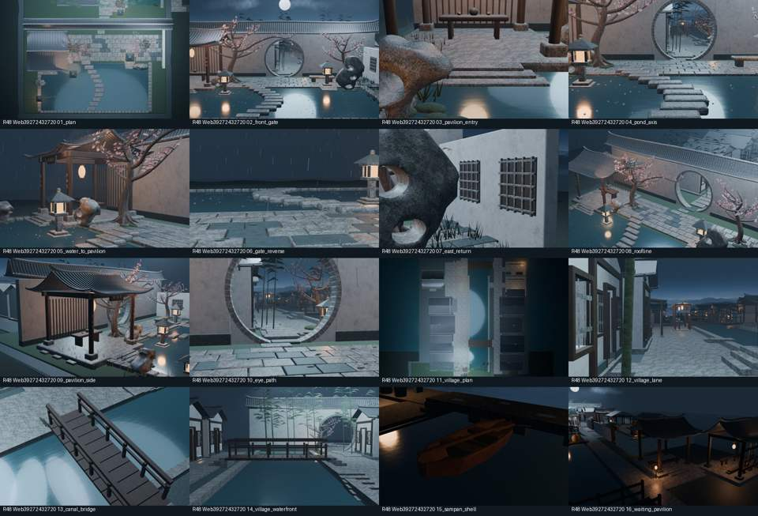
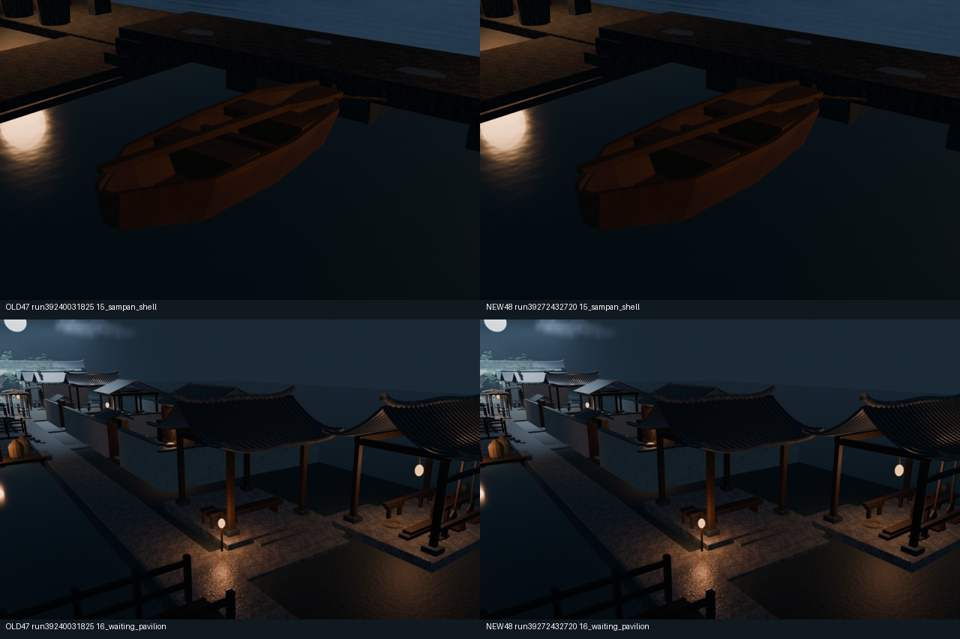
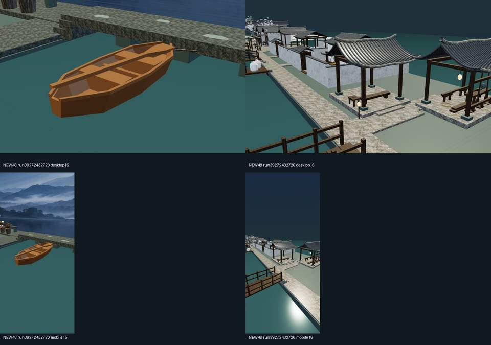

# Round48 — static stream sharing / actual render review

PR [#54](https://github.com/XDHRY/yanyu-jiangnan/pull/54) merged. Source `a0b1e4db232a9146197901fda9ca4dca59968c8c`; rendered/test commit `0f7505e845a1e001a103a7367cdce5b369fcc404`; actual merge `52a3c20ec8158032a20eed0f85a84b7d0965f51f`, same complete tree `0876d192ffea8d9924c254b1983267df0f47e96a`.

No new buildings, objects, triangles, images or materials. 795 exact attribute streams shared; same-build binary saved 1,384,364 bytes, GLB saved 1,493,004 bytes. All 9,048 primitive stream consumers match the same-build input exactly. 74 Python + 10 Node tests. CI39272433175, Smoke39272432732, Spatial39272432401, Web39272432720 all success; postmerge CI39274087548 and Smoke39274087467 success.

## Actual current 16 Blender views

Web build run39272432720, test commit above; 1024x640 originals in the persistent ZIP. These are model renders, not concepts. Thumbnails below are resized only.

## Focus comparison

Left OLD Round47 run39240031825; right NEW Round48 run39272432720. This is visual-invariance validation, not an expansion claim.

## Current browser checks

Four scene views from Chromium SwiftShader (not Blender lighting equivalence).

## Full original gallery, editable model and offline viewer

[Download durable review ZIP](https://chatgpt.com/api/library/files/libfile_510d7e99aff88191a12638637e388c79/download) (owner-authenticated; 124,437,241 bytes, SHA256 `5850e5dd88395ca6cd04b97e71d791d60fc75225e5b6ce5d03dfcbbca9175863`). Includes 85 files: gallery.html, all 16 originals, editable rebuilt Blender, GLB, standalone HTML, actual validation/performance, baseline-labelled focus images and desktop/portrait/sky evidence. Not repository source duplication.

GitHub Actions artifacts (expire): Smoke12195648285, Spatial12195993629, Web12197290554. [Web run](https://github.com/XDHRY/yanyu-jiangnan/actions/runs/39272432720), [Spatial run](https://github.com/XDHRY/yanyu-jiangnan/actions/runs/39272432401).

## Budgets, art review and remaining debt

4629 objects / 3111 Mesh / 1427 curves / 99734 faces / 168378 source triangles / 54 materials. GLB625571 triangles / 51573252 bytes / attribute-index28491802 of30000000 bytes (1508198 headroom), 9 image payloads unchanged /42.49MiB RGBA8 estimate, not physical VRAM/FPS. Spatial16 renders265.91s; Web's16 renders310.87s; no render-speedup claim. Runtime has no page errors; existing six-direction sky check passed.

All old nodes/materials/cameras/positions/normals/indices and packed-image bytes preserved versus Round47. Cross-build735 UV stream differences, max6.103515625e-5, remain unresolved; same-build optimization does not alter them. Mean per-channel screenshot difference <=0.00322/255. No complete-GLB cross-build determinism claimed.

No new support/path/roof defects observed in the reviewed views. North boat/roof shadows remain dark; browser water/material/light equivalence and terrain/panorama remain incomplete. Generic Form5 legacy failures and explicit human Form/Runtime approval, LOD/PBR/collision/navigation/device/accessibility/load checks remain pending. Independent inn repo untouched. Next: northern waiting-pavilion/oar-workshop connection night readability/material hierarchy within unchanged geometry caps; no overall acceptance yet.
