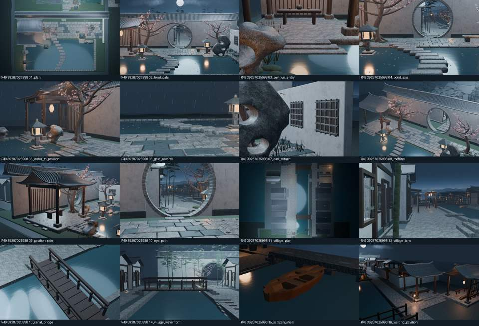
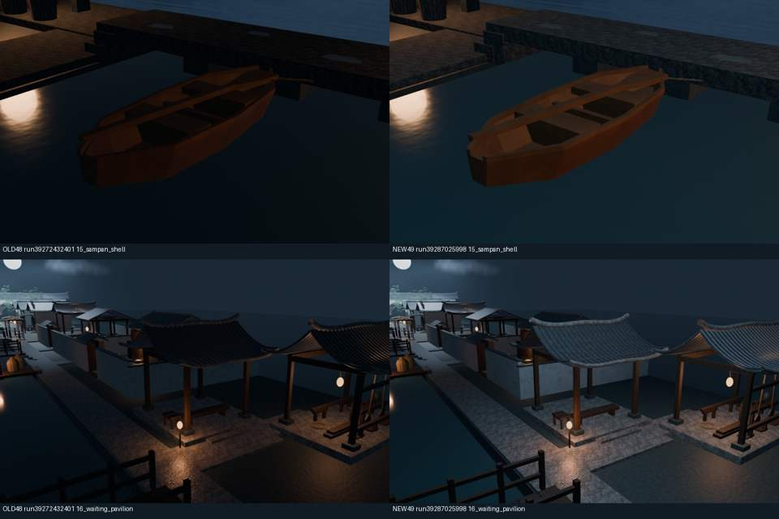

# Round49 北岸夜景真实审阅

[PR #55](https://github.com/XDHRY/yanyu-jiangnan/pull/55)已合并。源码`f67f253c7bbc78567b91364c763dc8436f9306be`，出图/测试`fc5291daeda6cb7139c7fc4bd95d8257b9eb244a`，实际合并`68875656b3a64dba8fe1b32b4e9e5a696c47c895`，测试与合并树同`84b495dd4921651d389ab15d7ac1e9661075d5ff`。

本轮新增两处柔和冷色月光、调整三盏既有工作灯，43盏非目标灯保留。0新几何/材质/图像/建筑，曝光及全部16机位保持。CI39287025800、Smoke39287025760、Spatial39287025998、Web39287025786全部通过；74Python+10Node通过。

## 本轮16张真实Blender渲染

Spatial39287025998，1024×640原图在完整ZIP；下图仅缩小预览。

## 同机位前后对比

左为旧Round48 Spatial39272432401，右为本轮49 Spatial39287025998。船舱内外壁/坐板/舷条和候船亭瓦面/柱脚/台阶层次改善，冷色塑形保留暖灯局部焦点。

## 完整审阅包

[下载76文件审阅包](https://chatgpt.com/api/library/files/libfile_587492ea69c081918a476d554a23242a/download)（所有者登录；122951010字节；SHA256 `4429f6e3de024b6d4769fc7de55bae1947466b16333a1ee271178aa5b0b85f39`）。包含gallery.html、16张原图、可编辑重建Blender、GLB、离线HTML、原始验证/性能报告、标注旧轮次的对照图和本轮4张网页/6天空方向检查图。Actions副本会过期，已另存持久审阅包。

[Spatial运行](https://github.com/XDHRY/yanyu-jiangnan/actions/runs/39287025998) / artifact12204806701；[Web运行](https://github.com/XDHRY/yanyu-jiangnan/actions/runs/39287025786) / artifact12204536084；Smoke artifact12203058561。归档SHA与CRC均检查。

实际4631对象/3111Mesh/1427曲线/99734面/168378源三角面/54材质/48灯；GLB625571三角面、51570700字节、属性索引28489306字节（余1510694），9图42.49MiB RGBA8估算，非设备VRAM/FPS。Spatial16图207.98s，Web内16图313.13s，不声称提速。

GLB位置/法线/索引/节点/材质/相机/9图内容保持；739UV流最大6.103515625e-5跨构建漂移仍待办。缓冲少2496字节为旧精确共享器的UV匹配波动，不计本轮照明收益。最终模型SHA256 `9ed9492372d65b521de9b7c6c28ff9966a748ff24440853f15465e453fb9899c`，同构建逐流校验/幂等和HTML嵌入模型比对通过。

Web导出器仍排除Blender灯光，4张网页捕获用于相机/模型回归，无页面错误；六方向天空检查通过。北岸改善由真实Blender图证明，网页灯光等价待实施。通用Form5旧缺失、人工验收、UV/PBR/LOD、碰撞导航、地形/全景、无障碍/载荷/实体设备仍未完成，独立客栈库未修改。

下一轮转东岸染纸院等不同连通生活节点的材料与陈设，先核最新main/PR/Actions和源1622/Web3584三角面余量。避免继续堆北岸灯光；整镇尚未验收。
