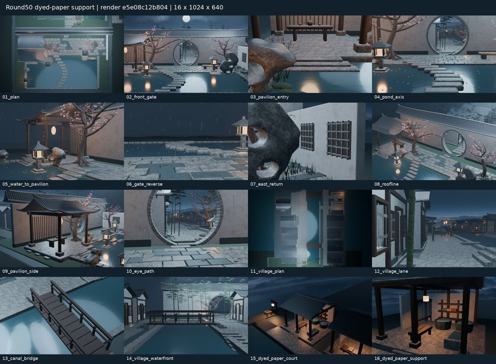
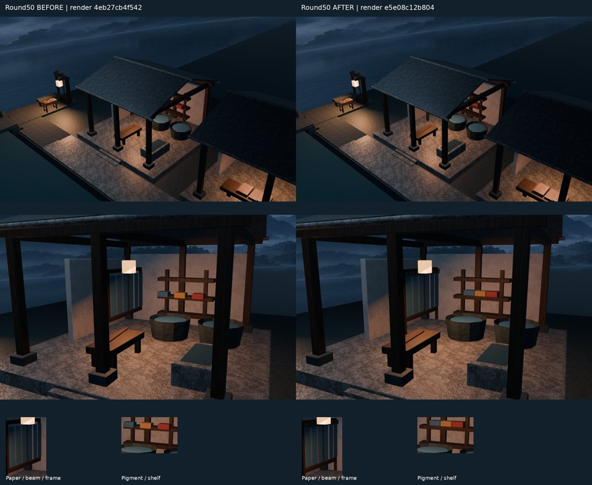

# Round50 东岸染纸院支撑精修 · 实际出图审阅

模型源 `6f084e9d718cda6145064cdbccc3d272686ad3b8`；测试/出图 `e5e08c12b8047495b6b1f7fa16365b058238a83e`；PR [#56](https://github.com/XDHRY/yanyu-jiangnan/pull/56) 已合并为 `7b6765007707d3be6ea92b40fcba532ead6d4b37`。测试、源、实际合并的模型树同为 `94665d6e3ca7ce7cf28a9a5dceea922a3ca4e006`。

两组均为本轮实际16×1024×640渲染；前图提交 `4eb27cb4f5426ec8125dcc302d931c51ca2d5159`，相机批源 `8ed0372fb5f7572bcf67b37ba2a1a584fb6494ce`，不是旧轮次图或概念图。14核心相机保留；15/16轮换至染纸院后，前后全部16个物理相机参数一致。无隐藏建筑或代理几何，无36正式渲染。

修复12既有对象（8脚柱、3颜料盒、1竹夹），新12只可见木纸夹复用1Mesh，另1隐藏原型；0新建筑/材质/贴图/灯。8脚柱落台、3盒完整承托、纸夹连接6张旧纸与上枋。独立客栈仓库未改。屋檐—柱梁—台基与临街踏步保留。

79Python+10Node；[CI39305671532](https://github.com/XDHRY/yanyu-jiangnan/actions/runs/39305671532)、[Smoke39305671536](https://github.com/XDHRY/yanyu-jiangnan/actions/runs/39305671536)、[Spatial39305671565](https://github.com/XDHRY/yanyu-jiangnan/actions/runs/39305671565)、[Web39305671598](https://github.com/XDHRY/yanyu-jiangnan/actions/runs/39305671598)全success。Native48+独立GLB48承托射线通过；3110非目标网格位置/法线/索引、旧节点关系/变换、材质/9图保持；725条跨构建UV微漂移最大6.103515625e-5，未声称确定性解决。4网页捕获/6向天空已审，page_errors为空；Web不导出Blender灯光。

实测4644对象/99812面/168534源三角面，Web625715三角面/51574032字节，属性索引28489906字节，分别余1466源三角面/3440Web三角面/1510094属性字节。9图42.49MiB为RGBA8估算，非VRAM/FPS实测。Spatial205.04秒/Web诊断205.10秒，不作提速结论。

完整独立审阅包 `jiangnan-round50-review.zip` 已在本对话保存：68文件、122528043字节，SHA256 `097b1b314245d46e015be5639fb5aceb1dcc6a06028b3d6346e80b6e65e684c8`。含32前后原图、可编辑打包Blender、实际GLB、离线HTML、网页视口及JSON；ZIP Library身份 `libfile_619a7151c04c8191999b20a29f28acc2`。原Actions产物有保留期限，持久ZIP为独立审阅副本。图中缩略图不代替原图。

原artifact：Smoke12212594259（SHA c590b8106407917a562e5e4e028a5e4ab73bbd3802f057aa9359601906ba80b5）；Spatial12212769516（SHA6f3b696402ec3c07e1ad3f8b3b97b4bb3abe60ac668ff3a14a6a261e3b7f687a）；Web12214012037（SHA7a9ed69981151bebe56db9394b7bcfb509b90ac68dcb309e8a6ea53e196b147a）。详见provenance/performance/glb-support JSON。

首批相机/回归失败已纠正，旧失败run不作本轮效果证据。通用Form缺7模板文件，人工Form/Runtime未通过；完整PBR/UV/LOD/碰撞、远山全景/地形截边、暗部材质、无障碍/载荷/真实设备仍待办，整镇未验收。下一轮优先染纸院/相邻纸坊既有材质物理尺度和UV稳定性证据；先读最新main/交接/开放PR，预算不放宽。
