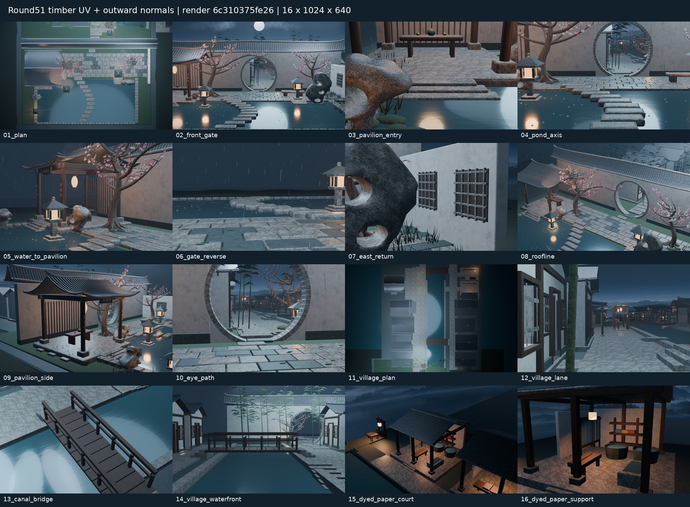
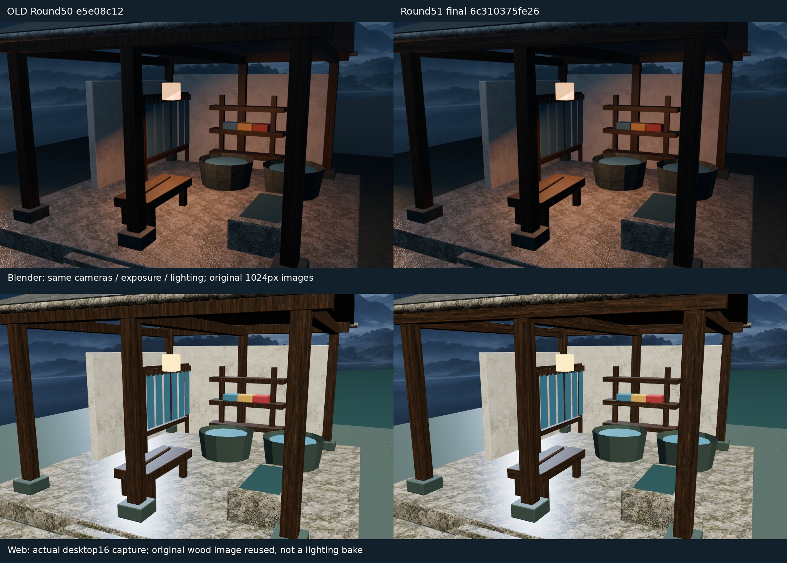
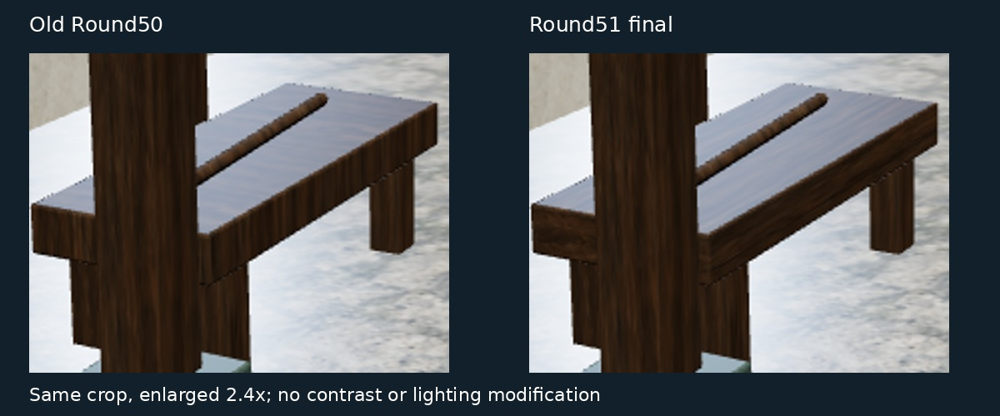

# Round51 染纸院顺纹与朝外法线 · 实际证据

源32f70112e022abf3007d8222b8f01ec01a9e5e9e，测试/出图6c310375fe261866f311d27e5f5cd8e2657266ca，PR57合并2309f27bccd2923b26464b793cba66c3bae03f6c；同模型树021a1571314b75dcad3c7bb9dc69cf2818efcbf6。不是概念图。

11旧木件显式源Mesh米制UV+朝外绕序修复，2共享局部材质，0新几何/位图/灯。176平面UV采样、11闭合正体积/每面朝外，3123非目标几何保留通过；见[独立审计](glb-grain51.json)、[性能](performance.json)、[完整来源身份](provenance.json)。86Python+10Node与四项构建通过。

- [Spatial39396940627：16张1024×640原图](https://github.com/XDHRY/yanyu-jiangnan/actions/runs/39396940627)，artifact12253585016。
- [Smoke39396940572：可编辑打包blend](https://github.com/XDHRY/yanyu-jiangnan/actions/runs/39396940572)，artifact12251849309。
- [Web39396940527：GLB/离线HTML/16图/4视口捕获/6天空](https://github.com/XDHRY/yanyu-jiangnan/actions/runs/39396940527)，artifact12252258470。
- [旧50原始Web基线：不是本轮图](https://github.com/XDHRY/yanyu-jiangnan/actions/runs/39305671598)。

完整75文件ZIP126592738字节，SHA256 9faa5a2f854c33c13eb8785269704d03e2032087f3ca57fab409f89e40752118。文件保存服务HTTP403拒绝，完整ZIP尚未持久化；本分支保存可审阅拼图与小型核验数据，Actions原产物有期限，不声称完整包永久保存。需恢复文件保存服务后补存。

4644对象/99812面/168534源三角面/56材质。Web625715三角面/28498114属性索引字节/51584888GLB字节；9图42.49MiB为RGBA8估算，非实测VRAM/FPS。Spatial305.99s/Web305.68s。上限未放宽；14核心+2聚焦保留，无36正式机位。

未完成：UV微漂移、端纹/接缝/完整PBR、LOD/碰撞、地形截边/全景/夜景暗部/设备/无障碍/载荷/人工验收。通用Form缺7模板，不记通过。下一轮转不同邻接生活节点或河岸边缘，先查main/PR/Actions与[主交接](https://github.com/XDHRY/yanyu-jiangnan/blob/main/docs/iterations/20261020-dyed-timber-grain.md)。独立客栈库未改。
