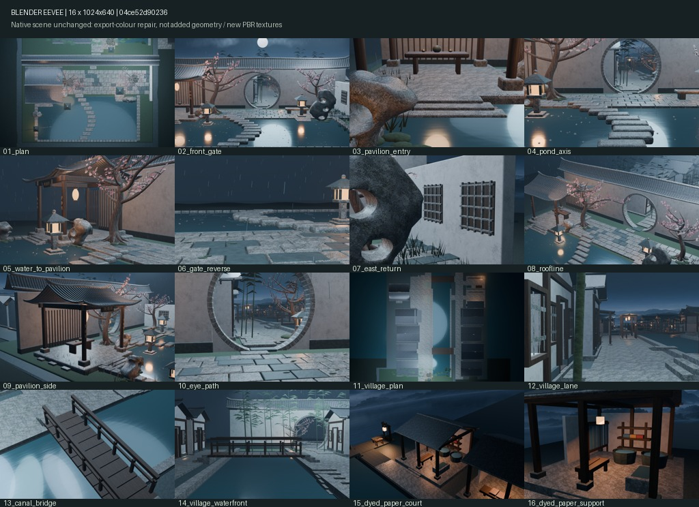
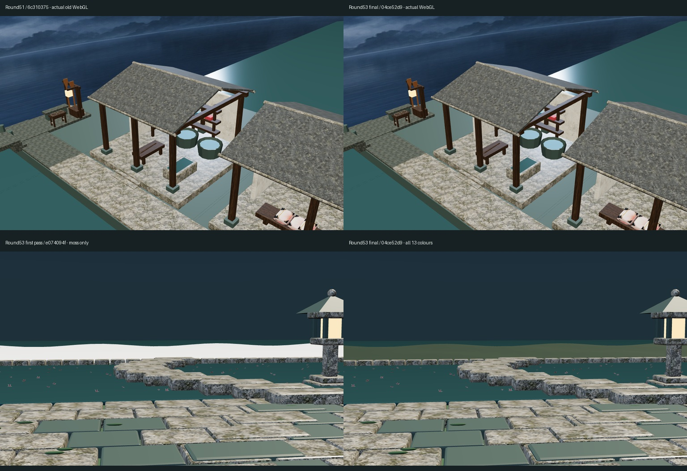

# Round53：实际模型、原图与离线动效审阅

PR [#60](https://github.com/XDHRY/yanyu-jiangnan/pull/60) 已合并 `a3ff3787587dfd90f0f8f5b1c9cd17ddbe57b2a8`。

- 模型源 `9446418c352ae89469e1f7bf77894688fd4bbd5b`，实际构建/出图 `04ce52d90236820915388555b219a202923c85d7`；同一完整树 `927dbec66d2bbc66eff8f76c1986987f657af577`。独立客栈库未改。
- 修复13类既有程序材质导出默认白色，共321个旧网格用户；0新建筑/几何/图片/材质/灯。保留原生shader与16机位，不是新增PBR细节。
- [CI39442184123](https://github.com/XDHRY/yanyu-jiangnan/actions/runs/39442184123)（95Python+10Node）、[Smoke39442184319](https://github.com/XDHRY/yanyu-jiangnan/actions/runs/39442184319)、[Spatial39442184144](https://github.com/XDHRY/yanyu-jiangnan/actions/runs/39442184144)、[Web39442184140](https://github.com/XDHRY/yanyu-jiangnan/actions/runs/39442184140)、[离线浏览器39442184155](https://github.com/XDHRY/yanyu-jiangnan/actions/runs/39442184155) 全success，合并前已看真实产物。
- Native4644对象/99812面/168534源三角/56材质，Web625715三角/55导出材质/51584788字节GLB/28494850属性索引字节；9图42.49MiB为RGBA8估算，不是实测显存/FPS。16原生图298.39秒，Web内16原生图208.53秒，不作提速结论。
- 实际GLB SHA `ee2dead87890a8fa2807be1f55db864f45b2ac8bd5c9d9228a612bcf6919f78e`。独立回读3134几何节点、全部有向三角角点/位置/法线、节点关系/变换、16相机、9图字节保留；只13项因子与同值源声明extras改变。726条跨构建UV流最大6.103515625e-5漂移，仍pending。

## 本轮16张真实Blender拼图

原生几何/shader未变；这些是本轮重新构建的验证图，不冒充网页颜色修复带来的原生美术提升。14核心+2焦点不变，长边1024；未恢复36正式渲染。

## 真实网页前后对比

第一行：左Round51真实Web39396940527/6c310375的15号截图，右本轮终版Web39442184140/04ce52d9同机位。

第二行：左本轮第一批Web39440290709/e074094f（仅moss修复）的06号截图，右本轮终版同机位；湿土白色恢复为原有深绿底色。不是概念图或重绘。仍可见远景断层、材质粗糙与层次不足。

## 下载与可编辑模型

- [完整16原始PNG/空间与性能报告](https://github.com/XDHRY/yanyu-jiangnan/actions/runs/39442184144)：artifact12273988484，SHA677f96105c12287f939d2ddb23b1f2583174730305ae4ef0da6eec7dcea65434。
- [原生packed .blend/断言](https://github.com/XDHRY/yanyu-jiangnan/actions/runs/39442184319)：artifact12275162351，SHAd16855a81139d9761e5b98d9aca5fb5871cc8b2db03950b676b9e3353786d589。
- [静态网页/实际GLB/6网页与6天空捕获](https://github.com/XDHRY/yanyu-jiangnan/actions/runs/39442184140)：artifact12275427426，SHA5359edb9106b79a12a0a501953c31b160f847e1b1fd9c1804693ed391d203b72。
- [完全离线动效HTML及7张实际浏览器截图](https://github.com/XDHRY/yanyu-jiangnan/actions/runs/39442184155)：artifact12274224013，SHAd1c4366ee39c6b3b540057615b1fa67f0ad8a3c6ea481e4fd65b32d1302c06f5。
- HTML70334853字节，SHAaabcc8c4615edc62ec13d3eaa30ff3b84d11ff27dc74a68292bd31ea8e8e69b6。模型与本轮GLB逐哈希相同，不再固定旧Round51 GLB。
- 19区域导航/10大水面法线波/700雨线或雪点/昼夜/暂停/折叠沉浸沿用并回归；1024×640和390×844，零外部请求/页面错误。同相机动态1041像素变化（阈值2），不是FPS。实体手机未测。

独立下载包在本轮对话提供，含完整HTML、16原始PNG、核验JSON及GLB提取脚本。图像/审计快照在此分支持久保留，Actions大产物遵守各自过期时间。

## 未完成与下一轮

- 55个导出材质仅第6户屋面1个材质有Normal和金属/粗糙度贴图，0个AO贴图；其余多用底色/标量粗糙度。不能宣称高精细目标完成。
- 原生.blend保留4444对象驱动和已有风雨雪；网页GLB导出没有动画片段，网页天气是运行时补充，不是流体、积雪碰撞或人物/船只动作。provenance的旧`Blender_animation_clips`字段实指GLB片段数，不能解读为源场景无驱动。
- 界面静态“真实模型Round51”标签仍指几何基线；实际已内嵌本轮源9446418c。下次真实模型批次应让标签读取provenance，勿再保留手写轮次。
- 全镇远景/地形连续性、11号总览遮挡、夜景暗部、作坊PR58未实现法线修复、LOD/碰撞/UV稳定性/真机与人工验收仍欠缺。通用Form仍5项旧schema/证据失败，未伪造人工通过；不是生产发布。
- 下一轮以可见木石Normal/Roughness/AO材质批次为优先，先合理整理贴图/导出预算，不连续只改底色或只优化提交数。保留14核心，必要时只轮换15/16为全镇真实总览和材质近景，先留前图；严守预算，不能以旧模型动效包冒充本轮。
